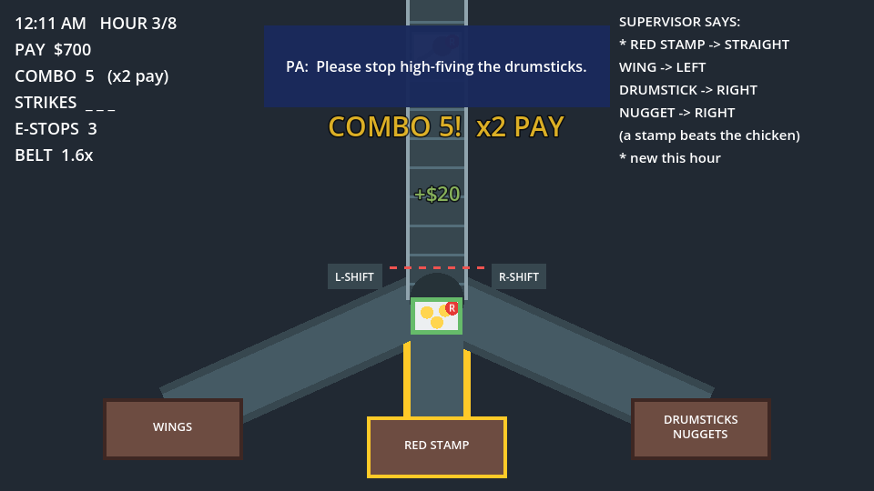

# Cluck Shift

You work the night shift on the packing line of a cartoon chicken factory. Trays of wings, drumsticks and nuggets
roll down to a fork, and the **only controls are the Shift keys**. Set the gate before each tray hits the red line.
Sort right for pay and combos; three strikes and you're sent home.

A [GitHub Game Off 2026](https://itch.io/jam/game-off-2026) entry for the theme **SHIFT**. Made with Godot 4.7
(GDScript), playable in the browser.



> **Status: Phase 1 of 4.** One endless shift on one belt, which keeps speeding up until you get three strikes. The
> night clock, supervisor rule changes, shop and the strange night are coming. See the [roadmap](#roadmap).

## Controls

| Key | Effect |
|---|---|
| **Left Shift** | Open / close the left gate |
| **Right Shift** | Open / close the right gate |
| **Both Shifts together** | Emergency stop: the belt halts for 2.5 s (3 per night) |
| Enter / Space | Menus only |

With both gates closed, trays go straight on. Opening one gate closes the other. No mouse, no other keys.

**Today's rules:** wings LEFT, drumsticks RIGHT, nuggets STRAIGHT. Each correct tray pays $10, multiplied by your combo
(x2 from 5 in a row, up to x5). A wrong exit is a strike.

> **Windows players:** pressing Shift five times opens the Sticky Keys prompt. Turn it off in
> Settings > Accessibility > Keyboard > Sticky keys > "Keyboard shortcut for Sticky keys".

## Run it

1. Install [Godot 4.7](https://godotengine.org/download) (the standard build, not .NET).
2. Clone this repo and open `project.godot` in Godot (Import, select the folder).
3. Press **F5**.

From a terminal: `godot --path .`

## Test it

```bash
godot --headless --path . --import                                # once, after cloning
godot --headless --path . -s tests/test_logic.gd                  # 44 rule checks
godot --headless --path . --fixed-fps 60 -s tests/test_play.gd    # plays the real scene for 150 s
```

Both exit with code 0 when everything passes. CI runs them on every push. Details: [docs/testing.md](docs/testing.md).

## Export for the web (itch.io)

```bash
godot --headless --path . --export-release "Web" build/web/index.html
```

Needs the Godot 4.7.2 web export templates. The preset has thread support off, so the build runs on itch.io with no
special headers. Upload steps: [docs/releasing.md](docs/releasing.md).

## Add or change a rule

Rules live in [`data/rules.json`](data/rules.json), not in code:

```json
"routes": { "wing": "left", "drumstick": "right", "nugget": "center" }
```

- **Move a kind to another exit:** change its value to `"left"`, `"center"` or `"right"`. The rules board and the bin
  labels update themselves.
- **Add a tray kind:** add it to `routes` (for example `"tender": "left"`), then give it a colour in `Tray.FOOD` and a
  drawing in `Tray._draw()` (`scripts/tray.gd`). The tests fail until it has art.
- **Retune difficulty:** pay, strikes, emergency stops and the belt speed ramp are all in the same file.

Then run the tests: they check every route is a real exit, trays can't overlap, and a perfect player can still keep
up at full speed. Field reference: [docs/data-format.md](docs/data-format.md).

## Documentation

| Doc | What's in it |
|---|---|
| [docs/design.md](docs/design.md) | Game design: core loop, gate and game state machines, emergency stop logic, scoring formulas, difficulty curve, and the plan for Phases 2 to 4, with diagrams |
| [docs/architecture.md](docs/architecture.md) | Scene tree, which script owns what, the frame and input flow, how to extend it |
| [docs/data-format.md](docs/data-format.md) | Every field in `rules.json` |
| [docs/testing.md](docs/testing.md) | What the tests prove, and the manual playtest checklist |
| [docs/releasing.md](docs/releasing.md) | Exporting and uploading to itch.io |

## Project layout

```
data/rules.json        rules and tuning
scenes/                main.tscn (the game), tray.tscn
scripts/shift_state.gd every game rule, no nodes: what the tests drive
scripts/main.gd        game states, input, spawning, HUD
scripts/belt.gd        draws the belt, fork, gates and bins
scripts/tray.gd        a tray: movement and drawing
scripts/sfx.gd         sound hooks (placeholder beeps)
tests/                 headless test scripts
```

## Roadmap

| Phase | Scope | Status |
|---|---|---|
| 1 | Belt, fork, 3 tray types, Shift gates, emergency stop, scoring, combo, strikes, game over | Done |
| 2 | 10pm to 6am night clock, per-hour speed ramp, supervisor rule changes, pay tally, win at 6am | Next |
| 3 | Shop between hours (Coffee, Mate's Help, Earplugs), screen shake, particles, popups, sounds, title screen | Planned |
| 4 | Strange trays from 2am, flickering lights, radio glitches, normal and secret endings | Optional |

Each item is a [GitHub issue](../../issues). Changes are listed in [CHANGELOG.md](CHANGELOG.md).

## Contributing

See [CONTRIBUTING.md](CONTRIBUTING.md). Keep it cartoony: no gore.

## Licence

[MIT](LICENSE).
