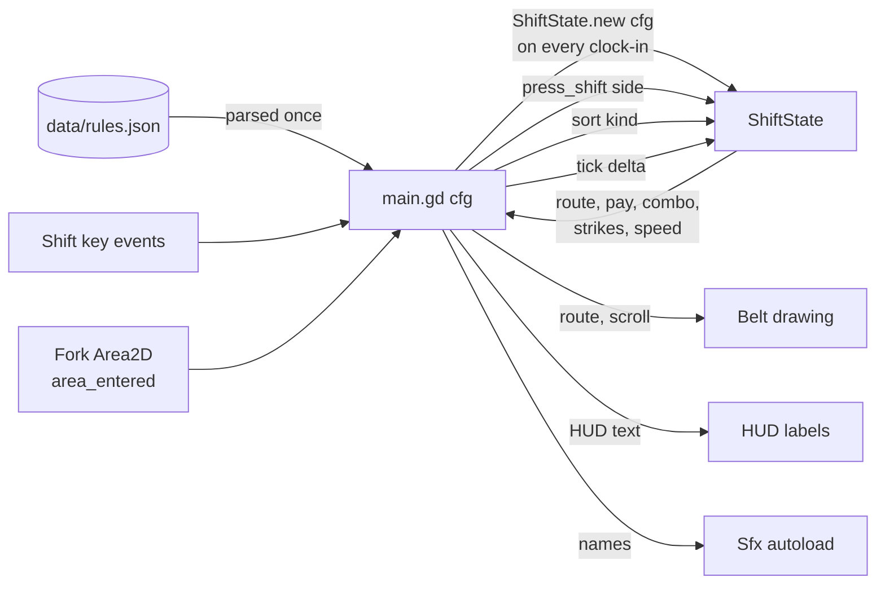

# Architecture

How the Godot project is put together, which script owns what, and where to make common changes.
For the game rules themselves, see [design.md](design.md).

## Files

```
cluck_shift/
├── project.godot          # 960x540, GL Compatibility renderer, Sfx autoload, main scene
├── export_presets.cfg     # "Web" preset: no threads, so it runs on itch.io without special headers
├── data/
│   └── rules.json         # routes, pay, strikes, e-stops, belt ramp (docs/data-format.md)
├── scenes/
│   ├── main.tscn          # the whole game screen
│   └── tray.tscn          # one tray (Area2D)
├── scripts/
│   ├── shift_state.gd     # ShiftState: every rule, no nodes (the part the tests drive)
│   ├── main.gd            # scene glue: state machine, input, spawning, moving trays, HUD
│   ├── belt.gd            # Belt: draws belt, fork, gates, bins; owns the layout points
│   ├── tray.gd            # Tray: path following and drawing
│   └── sfx.gd             # Sfx autoload: named sound hooks (placeholder beeps for now)
├── tests/
│   ├── test_logic.gd      # 44 checks on ShiftState, Tray.advance and rules.json
│   └── test_play.gd       # plays main.tscn headless with real key events
└── docs/                  # this folder
```

## Scene tree

```
Main (Node2D)                 main.gd     state machine, input, spawning, HUD text
├── Belt (Node2D)             belt.gd     draws everything static; reads route + scroll
├── Trays (Node2D)                        parent of all live Tray instances (draw order: above Belt)
│   └── Tray (Area2D) ...     tray.gd     one per tray, from tray.tscn
│       └── Shape (CollisionShape2D)      52 x 36 rectangle
├── Fork (Area2D)                         the commit zone; area_entered -> main._on_tray_at_fork
│   └── Shape (CollisionShape2D)          80 x 20 rectangle, placed at Belt.FORK + (0, -25) in _ready
├── SpawnTimer (Timer)                    one-shot; restarted with logic.interval after every spawn
└── HUD (CanvasLayer)
    ├── Stats (Label)                     pay, combo, strikes, e-stops, belt speed
    ├── Rules (Label)                     "SUPERVISOR SAYS" board, built from rules.json
    └── Dim (ColorRect)                   overlay for menu / game over
        └── Message (Label)
```

Autoload: `Sfx` (`scripts/sfx.gd`), one `AudioStreamPlayer` per named sound.

## Who owns what

| Script | Owns | Does not do |
|---|---|---|
| `shift_state.gd` (`ShiftState`, RefCounted) | Route, game clock, belt speed and interval, pay, combo, strikes, e-stops, accuracy | Nodes, drawing, sound, input events |
| `main.gd` | Which state the game is in, turning key events into `press_shift`, spawning and moving trays, reacting to the Fork, HUD text | Any rule arithmetic |
| `belt.gd` (`Belt`) | Layout constants (`SPAWN`, `FORK`, `EXITS`, `DECISION_Y`) and drawing the line | Game logic |
| `tray.gd` (`Tray`) | Its kind, its remaining path, whether it has been routed, its result outline | Deciding where it goes |
| `sfx.gd` (`Sfx`) | Turning a sound name into a sound | Knowing when to play |

The split exists for one reason: **every rule is in a class with no nodes, so it can be tested directly** and the
scene can be rebuilt (Phase 3 art and juice) without touching a rule.

## Data flow



## The physics frame

`main._physics_process` runs only in PLAYING:

1. `step = logic.tick(delta)`: advances the clock and ramp, returns the belt distance (0 during an e-stop).
2. `spawn_timer.paused = logic.is_stopped()`.
3. Every tray `advance(step)`s along its path. A tray that has been routed and has used up its path has reached its
   bin: play `tray_thunk`, `queue_free()`. Trays already queued for deletion are skipped, because several physics
   frames can run before the idle frame that frees them.
4. HUD and Belt redraw from `logic`.

The physics server then checks overlaps. When a tray's shape first overlaps the Fork's shape, `area_entered` calls
`_on_tray_at_fork(tray)`, which:

1. ignores it unless PLAYING and the tray is not already routed,
2. sets `tray.routed`, appends `Belt.EXITS[logic.route]` to the tray's path,
3. calls `logic.sort(tray.kind)`, outlines the tray green or red, plays `ding` or `strike_buzz`,
4. enters GAME_OVER if `logic.sent_home()`.

Collision setup: trays have `monitoring = false` (they never look for anything) and stay `monitorable`. The Fork has
`monitorable = false` and stays `monitoring`. Both are on the default layer and mask 1.

## Input path

`main._unhandled_input` receives key events:

- Released keys and echo (auto-repeat) events are ignored.
- Outside PLAYING, Enter, keypad Enter and Space call `_enter(State.PLAYING)`. Everything else is ignored.
- In PLAYING, only `KEY_SHIFT` counts. `event.location == KEY_LOCATION_LEFT` means left; anything else means right.
  `logic.press_shift(side)` returns `toggle`, `estop` or `denied`, which picks the sound.

Using `_unhandled_input` (not `_input`) means a future pause menu or UI control can consume keys first.

## How to change things

### Change where a tray kind goes

Edit `routes` in `data/rules.json`. The rules board and bin labels update on the next launch. Run the tests.

### Add a new tray kind

1. Add it to `routes` in `data/rules.json`, for example `"tender": "left"`. It starts spawning.
2. Add its colour to `Tray.FOOD` and a `match` branch in `Tray._draw()` in `scripts/tray.gd`.
3. Run `tests/test_logic.gd`. It fails with "tray art exists for tender" if you skip step 2.

### Retune difficulty

Change the `belt` block in `data/rules.json`. The data tests fail if trays could overlap or if trays at full speed are
less than 0.6 s apart. Re-run `tests/test_play.gd` to check a perfect player can still keep up.

### Add a sound

Add a name to `Sfx.TONES` (or, from Phase 3, load a file) and call `Sfx.play("name")` where it should play.
Unknown names are ignored, so a missing sound never crashes the game.

### Add a game state (Phase 2)

1. Add it to `enum State` in `main.gd`.
2. Add a branch to `_enter()` for what happens on entry.
3. Decide in `_unhandled_input` which keys it accepts.
4. Add a check to `tests/test_play.gd` that drives into and out of it.

## Phase 2 hooks

These are the places Phase 2 plugs into. They do not exist yet:

- **Hour timer**: a second `Timer` (`HourTimer`, one-shot, `wait_time = hour_seconds`) under Main. On timeout,
  `_enter(State.HOUR_END)`. Paused during e-stops like `SpawnTimer`.
- **Per-hour rules**: `ShiftState` gains `apply_note(note)` and takes the hour's belt numbers. The route lookup in
  `sort()` becomes "stamp rule, else kind rule".
- **Strikes per hour**: HOUR_END keeps pay, best combo and accuracy totals and resets `strikes`.
