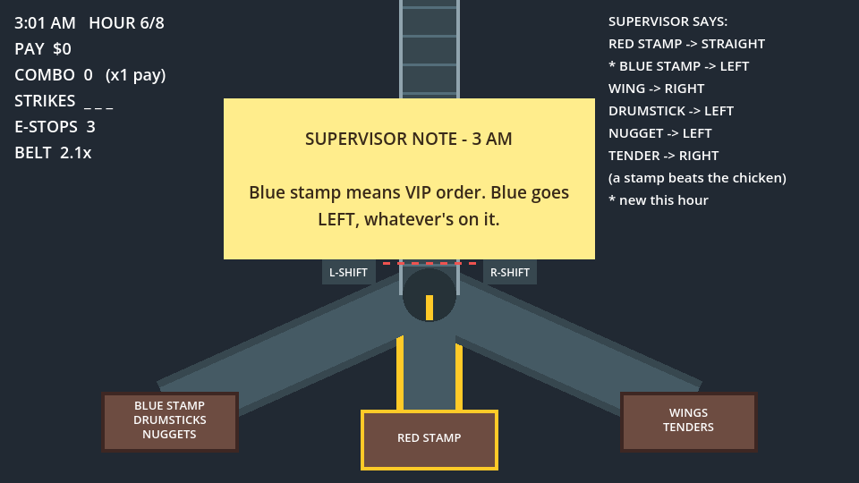
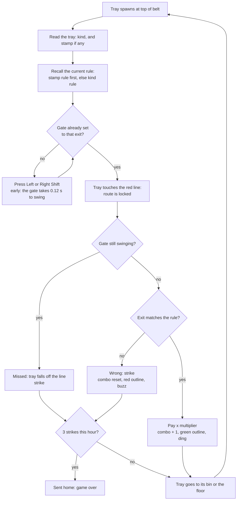
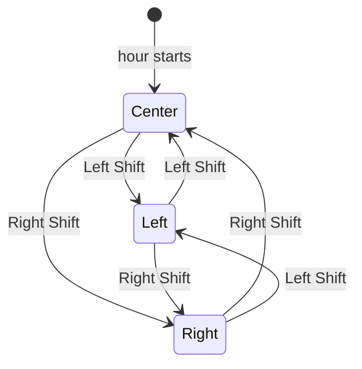
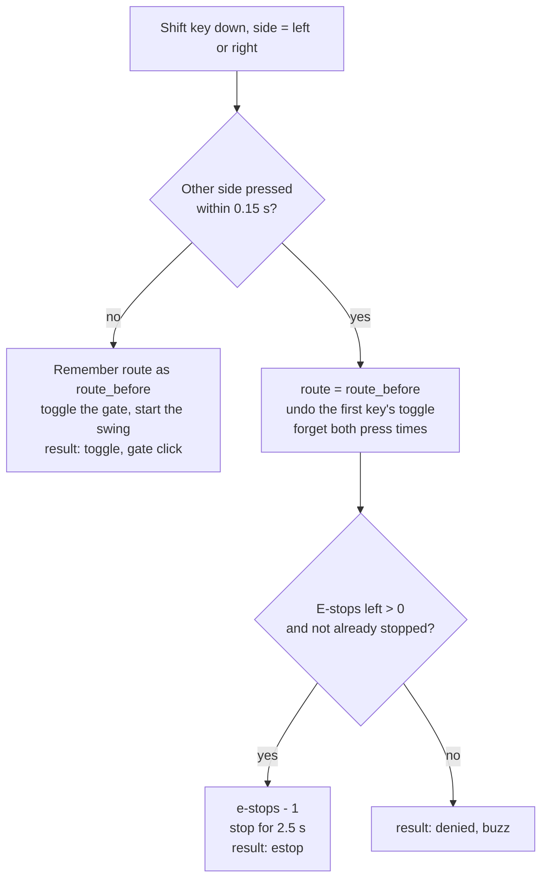
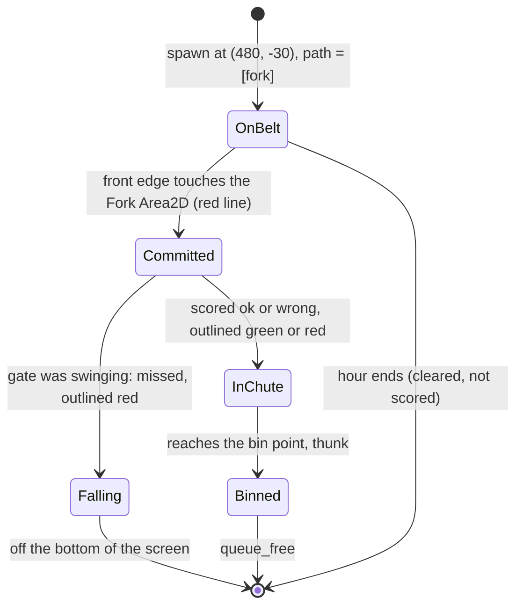
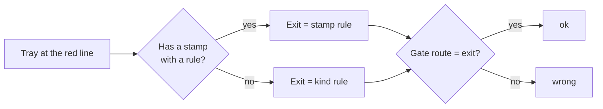
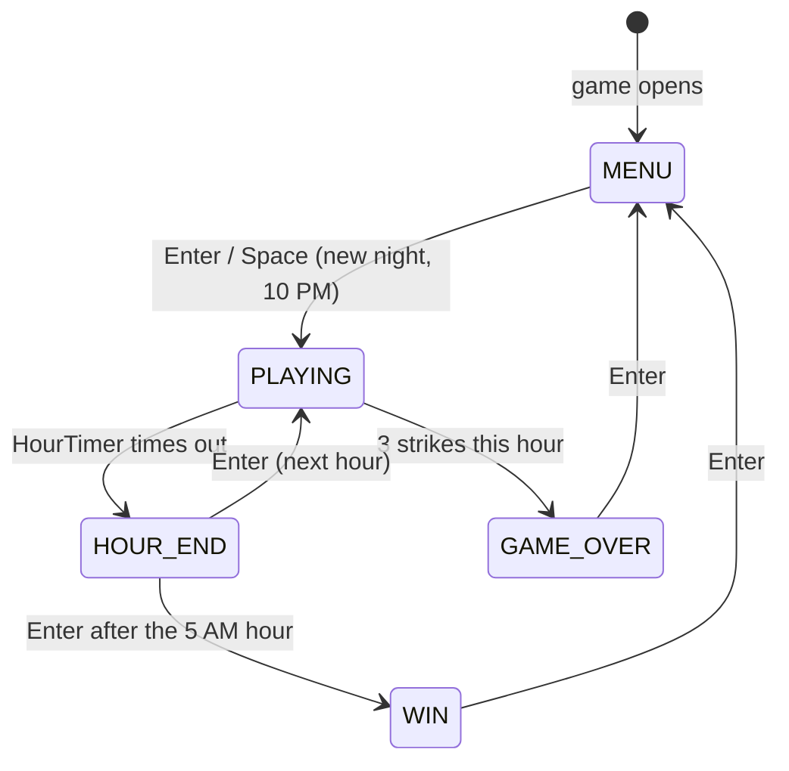
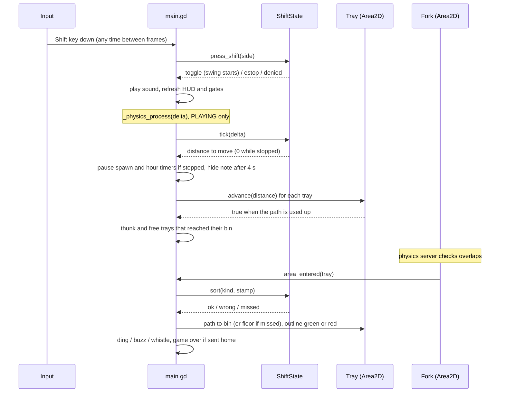

# Cluck Shift: game design document

Game Off 2026 entry. Theme: **SHIFT**. Engine: Godot 4.7 (GDScript), exported to HTML5 for itch.io.

| Phase | Scope | Status |
|---|---|---|
| 1 | One belt, one fork, three tray types, Shift gates, emergency stop, scoring, combo, strikes, game over | Done |
| 2 | Night clock 10 PM to 6 AM, per-hour speed ramp, supervisor rule changes, stamps, missed trays, pay tally, win at 6 AM | **Done** |
| 3 | Shop between hours, juice (shake, particles, popups), real sounds, title screen | Next |
| 4 | Strange trays from 2 AM, flicker, radio glitches, normal and secret endings | Optional |

Sections 1 to 16 describe what is built and tested. Section 17 is the plan for Phases 3 and 4. Every number comes
from [`data/rules.json`](../data/rules.json) or a named constant, and the tests in [`tests/`](../tests) check the
rules written here (see [testing.md](testing.md)).

---

## 1. Pitch

You work the night shift on the packing line of a cartoon chicken factory, 10 PM to 6 AM. Trays of chicken roll down
a conveyor to a three-way fork. You have two buttons, **Left Shift** and **Right Shift**, which swing the gates at the
fork. Read each tray, remember where it goes, set the gate before it reaches the red line. Every hour the supervisor
leaves a note that changes one rule. Get it right for pay and combos. Three strikes in one hour and you're sent home.

## 2. How the game uses "SHIFT"

| Meaning of shift | Where it shows up |
|---|---|
| The Shift keys | They are the only gameplay controls. |
| A night shift | You clock in at 10 PM and the night ends at 6 AM. |
| Shifting gears | The belt speeds up within every hour and starts faster each hour. |
| Shifting rules | Each hour the supervisor changes one rule: kinds move, stamps appear, chutes swap. |
| Shifting reality | From 2 AM things on the line stop making sense (Phase 4). |

## 3. Design pillars

1. **Two keys, nothing else.** Every gameplay decision is a Shift press. Enter and Space only drive menus. No mouse.
2. **Read, then commit.** The player can always see the next tray coming and has a clear moment (the red line)
   after which the decision is locked. A strike is always the player's choice, never a surprise.
3. **The rules move under you.** Each hour changes one thing. The challenge is memory and attention as much as
   reflexes, and the board always shows the current rules with the new one marked.
4. **Light and cartoony.** Bright shapes, silly supervisor notes, no gore.
5. **Rules are data.** Routes, notes, pay, strikes and belt speeds live in `data/rules.json`.

## 4. Controls

| Input | When | Effect |
|---|---|---|
| Left Shift | Playing | Toggle the left gate. Opening it closes the right gate. |
| Right Shift | Playing | Toggle the right gate. Opening it closes the left gate. |
| Both Shifts (within 0.15 s) | Playing | Emergency stop: the belt and the hour clock halt for 2.5 s. 3 per night. |
| Enter / Space | Menu, hour tally, game over, win | Continue. |
| Anything else | Any | Ignored. |

Only key-down events count. Key repeat (echo) is ignored, so holding a Shift is one press. Left and right are told
apart by the key's `location` (`KEY_LOCATION_LEFT` / `KEY_LOCATION_RIGHT`), which Godot reads from the OS on desktop
and from `KeyboardEvent.location` in the browser.

## 5. Screen layout

The viewport is 960 x 540 and scales with the window (`stretch/mode = canvas_items`).

```
 x=0                              x=480                              x=960
 +-----------------------------------------------------------------------+ y=0
 | 11:42 PM  HOUR 2/8              |    |    SUPERVISOR SAYS:            |
 | PAY  $640                       |[T] |    RED STAMP -> STRAIGHT       |
 | COMBO 7  (x2 pay)               |    |    WING -> LEFT                |
 | STRIKES X _ _      +--------------------+ * NUGGET -> RIGHT           |
 | E-STOPS 3          | SUPERVISOR NOTE    |  (a stamp beats the chicken)|
 | BELT 1.4x          | (first 4 s of the  |  * new this hour            |
 |                    |  hour only)        |                             |
 |                    +--------------------+                             |
 |                      [L-SHIFT] - - - - - [R-SHIFT]   <- red line y=295|
 |                                 \ () /   fork hub at (480, 330)       |
 |                    /             |               \                    |
 |          +--------+         +---------+         +--------+            |
 |          | WINGS  |         |RED STAMP|         | DRUMS  |            |
 |          +--------+         +---------+         | NUGGETS|            |
 +-----------------------------------------------------------------------+ y=540
     left bin (190,460)      centre bin (480,480)     right bin (770,460)
```

The open route is drawn in yellow: its gate box, chute outline, bin outline and the arrow on the fork hub. While a
gate is swinging both gate boxes flash orange. Bin labels list everything that goes in that bin (up to three lines)
and are rebuilt whenever the rules change.




## 6. Core loop



Several trays are on the belt at once, so the real rhythm is: set the gate for the front tray, then look up at the
next one while the front tray is still travelling.

## 7. Gates

### 7.1 Route model

The fork has three exits: `left`, `center` (straight on) and `right`. The game stores a single `route`:

- Both gates closed means `route = "center"`: trays go straight.
- Left gate open means `route = "left"`. Right gate open means `route = "right"`.

Both gates can never be open at once. That avoids the question of where a tray goes when both are open, and keeps
"both keys together" free for the emergency stop. The gates close at the start of every hour.

### 7.2 Gate state machine



| Current route | Left Shift | Right Shift |
|---|---|---|
| center | left | right |
| left | center | right |
| right | left | center |

The rule fits in one line: `route = "center" if route == side else side`. Every route is one press away from every
other route, so the player never needs two presses to reach a target, which is what makes "two presses at once"
safe to read as an emergency stop.

### 7.3 Gate swing and missed trays

Every toggle starts the gate swinging for `swing_seconds` (0.12 s); both gate boxes flash orange while it swings. A
tray that reaches the red line while the gate is swinging is **missed**: it tumbles off the line to the floor and is a
strike, whatever the gate was swinging towards.

- This is the brief's "missed tray". A press made in good time never misses; a panicked last-frame press does.
- 0.12 s is shorter than the both-Shifts window, so it never adds to the emergency stop's timing (tested).
- The swing keeps running during an emergency stop, but nothing reaches the red line then.

## 8. Emergency stop

### 8.1 Rules

- Pressing **both Shifts within 0.15 s** of each other (`ShiftState.BOTH_SHIFT_WINDOW`) is an emergency stop.
- For `estop_seconds` (2.5 s) the belt halts, trays freeze, no new trays spawn, the speed ramp pauses and **the hour
  clock stops** (both the `HourTimer` and the clock on the HUD).
- The gates still work during the stop. That is the point: it buys time to fix the gate.
- `estops` (3) per **night**, not per hour. With none left, the double press is refused (buzz) and nothing happens.
- A double press during a stop is refused and does not use a charge, so stops cannot be stacked.
- The double press never changes the gate: the first key's toggle is undone.

### 8.2 Detection logic



Press times are measured on the game clock (`ShiftState.clock`), not the wall clock, so the logic behaves the same in
tests that run faster than real time. Forgetting both press times after a pair means a quick third press starts
fresh.

### 8.3 Edge cases

| Situation | Result |
|---|---|
| Same Shift pressed twice quickly | Two toggles (gate opens and closes). No stop. |
| Left, then Right 0.2 s later | Two toggles. Too slow to count as "both". |
| Left and Right in the same frame | Emergency stop, gate unchanged. |
| Both again during a stop | Refused, no charge used, gate unchanged. |
| Both with 0 charges left | Refused, buzz, gate unchanged. |
| Holding a Shift | Echo events ignored, so it counts as one press. |
| Shift on a tally, game over or win screen | Ignored. Only Enter or Space do anything. |

## 9. Trays

### 9.1 Kinds and stamps

| Tray | Drawing | Colour | Appears |
|---|---|---|---|
| Wing | Orange angular wing | `#ffa726` | All night |
| Drumstick | Brown ball on a bone | `#a1653a` | All night |
| Nugget | Three small yellow circles | `#ffd54f` | All night |
| Tender | Two long golden strips | `#d4a373` | From 1 AM (a note adds it) |
| Red stamp | Round red badge with "R", top right | `#e53935` | 12 AM to 5 AM |
| Blue stamp | Diamond blue badge with "B", top right | `#1e88e5` | From 3 AM |

Kinds and stamps differ in shape as well as colour, so they can be told apart without colour vision. A new tray's
kind is picked uniformly from the kinds that currently have a rule. While any stamp rule exists, `stamp_chance` (30%)
of trays get a stamp, picked uniformly from the stamps that have a rule.

**A stamp rule beats the kind rule.** A red-stamped wing goes where red stamps go. A tray with no stamp, or with a
stamp that has no rule, goes where its kind goes.

### 9.2 Tray lifecycle



A tray is scored exactly once (`Tray.routed` guards the handler). An emergency stop freezes trays in every state.
When the hour ends, trays still on the belt are cleared without being scored, so the last seconds of an hour can
never cost a strike.

### 9.3 The commit point (the red line)

The Fork is an `Area2D` with an 80 x 20 rectangle centred at (480, 305), so its top edge is at y = 295. A tray is
52 x 36. When its front edge touches y = 295 (tray centre at y = 277), Godot reports the overlap and the tray is routed
by whatever the gate says at that moment. The red dashed line is drawn exactly at y = 295 (`Belt.DECISION_Y`), so
what the player sees matches what the physics does.

## 10. Scoring

### 10.1 Formulas

```
correct sort:  combo      = combo + 1
               multiplier = min(1 + floor(combo / 5), 5)
               pay        = pay + pay_per_tray * multiplier
wrong/missed:  combo      = 0
               strikes    = strikes + 1           (pay is never taken away)
end of hour:   bonus      = clean_hour_bonus if strikes == 0 and at least one tray sorted, else 0
               pay        = pay + bonus
accuracy     = correct / sorted over the night    (0 when nothing sorted)
sent home    = strikes this hour >= strikes_allowed
```

The multiplier is computed after the combo goes up, so the 5th correct tray in a row is the first paid at x2.
**The combo carries across hours**; strikes do not.

### 10.2 Multiplier table (pay_per_tray = 10)

| Combo after the sort | Multiplier | Pay for that tray |
|---|---|---|
| 1 to 4 | x1 | $10 |
| 5 to 9 | x2 | $20 |
| 10 to 14 | x3 | $30 |
| 15 to 19 | x4 | $40 |
| 20+ | x5 (cap) | $50 |

Worked example (a test): four wings right ($40), a fifth ($20, total $60), then a nugget sent left: strike, combo 0,
pay stays $60, accuracy 5/6 = 83%. A perfect night is about 405 trays: $490 for the first 19, then $50 each, plus
8 clean-hour bonuses of $100: the headless autoplayer earns **$20,590**.

### 10.3 Strikes

- A strike is a tray sent to the wrong exit, or a tray that misses a swinging gate.
- 3 strikes **in one hour** and you are sent home, immediately. Strikes reset at the start of every hour.

## 11. The night

### 11.1 Hours and clock

Eight hours, 10 PM to 6 AM, each `hour_seconds` (75 s) of play. The HUD clock runs from `10:00 PM` to `5:59 AM`,
one in-game minute per 1.25 s. The clock, the `HourTimer` and the belt ramp all stop during an emergency stop.

Each hour starts the same way: the belt clears, the gates close, strikes reset, the supervisor's note applies and is
shown on a sticky note for `note_seconds` (4 s), and the first tray spawns when the note goes away.

### 11.2 Belt per hour

Speed and interval slide linearly from the hour's first to its second value:

```
p           = hour_elapsed / hour_seconds          (0 to 1, not counting emergency stops)
speed(p)    = lerp(speed[0], speed[1], p)          px/s
interval(p) = lerp(interval[0], interval[1], p)    s between trays
```

| Hour | Speed (px/s) | Seconds between trays | Gap between trays | Time from spawn to red line | Trays (approx.) |
|---|---|---|---|---|---|
| 10 PM | 100 to 150 | 2.6 to 2.0 | 260 to 300 px | 3.1 to 2.0 s | 31 |
| 11 PM | 130 to 180 | 2.2 to 1.7 | 286 to 306 px | 2.4 to 1.7 s | 36 |
| 12 AM | 150 to 200 | 1.9 to 1.5 | 285 to 300 px | 2.0 to 1.5 s | 42 |
| 1 AM | 170 to 220 | 1.7 to 1.3 | 289 to 286 px | 1.8 to 1.4 s | 47 |
| 2 AM | 190 to 240 | 1.5 to 1.2 | 285 to 288 px | 1.6 to 1.3 s | 53 |
| 3 AM | 210 to 255 | 1.3 to 1.05 | 273 to 268 px | 1.5 to 1.2 s | 60 |
| 4 AM | 225 to 270 | 1.15 to 0.95 | 259 to 257 px | 1.4 to 1.1 s | 68 |
| 5 AM | 240 to 280 | 1.05 to 0.9 | 252 px | 1.3 to 1.1 s | 73 |

```mermaid
xychart-beta
    title "Belt speed through the night (px/s, start and end of each hour)"
    x-axis ["10PM", "", "11PM", "", "12AM", "", "1AM", "", "2AM", "", "3AM", "", "4AM", "", "5AM", ""]
    y-axis "px/s" 0 --> 300
    line [100, 150, 130, 180, 150, 200, 170, 220, 190, 240, 210, 255, 225, 270, 240, 280]
```

- **Gap** is `speed x interval` when a tray spawns. All trays move at the same speed, so gaps never shrink after
  spawning, and every gap is far above the 36 px tray height (tested for every hour).
- **Seconds between trays** is the decision budget per tray. It never drops below 0.9 s (tested: at least 0.6 s).
- **Time from spawn to red line** is the 307 px from spawn to commit divided by speed: how long you can read a tray.
- Each hour starts a little slower than the last one ended, so a new rule arrives with a moment to adjust.

## 12. Supervisor notes

### 12.1 Note types

A note is data in `hours[i].note`. After the first hour, every note changes **exactly one rule** (tested):

| Field | Effect | Example |
|---|---|---|
| `route` `{kind: exit}` | Moves a kind to an exit. A kind with no rule yet starts spawning. | `{"nugget": "right"}`, `{"tender": "left"}` |
| `stamp` `{colour: exit}` | Stamped trays of that colour go to that exit, beating their kind. | `{"red": "center"}` |
| `stamp` `{colour: null}` | Cancels a stamp rule. Those stamps stop appearing. | `{"red": null}` |
| `swap` `[exit, exit]` | Every kind and stamp going to one exit now goes to the other. | `["left", "right"]` |

When a note applies, the rules board marks every rule it changed with `*` (a cancelled stamp is listed as
"cancelled"), and the bins relabel. Notes change a copy of the rules, never the data a new night starts from (tested).

### 12.2 The night's rules, hour by hour

| Hour | Supervisor note | LEFT bin | STRAIGHT bin | RIGHT bin |
|---|---|---|---|---|
| 10 PM | "Wings LEFT, drumsticks RIGHT, nuggets STRAIGHT on." (no change) | wings | nuggets | drumsticks |
| 11 PM | "Nuggets now go RIGHT. Same box as the drumsticks." | wings | (empty) | drumsticks, nuggets |
| 12 AM | "Red-stamped trays go STRAIGHT to the bin." | wings | RED STAMP | drumsticks, nuggets |
| 1 AM | "Tenders are on tonight. Tenders go LEFT." | wings, tenders | RED STAMP | drumsticks, nuggets |
| 2 AM | "Maintenance swapped the chutes." | drumsticks, nuggets | RED STAMP | wings, tenders |
| 3 AM | "Blue stamp means VIP order. Blue goes LEFT." | BLUE STAMP, drumsticks, nuggets | RED STAMP | wings, tenders |
| 4 AM | "Wing shortage upstairs. Wings go STRAIGHT now." | BLUE STAMP, drumsticks, nuggets | RED STAMP, wings | tenders |
| 5 AM | "Red stamps were a printer error." | BLUE STAMP, drumsticks, nuggets | wings | tenders |

The 2 AM swap is the hardest moment: every habit built so far is reversed. The play test replays this exact sequence
and checks the board marks each new rule.

### 12.3 Rule lookup



## 13. Game states

### 13.1 State machine



| State | On enter | Input | Per physics frame | Leaves when |
|---|---|---|---|---|
| MENU | New `ShiftState`, clear trays, show title and controls | Enter, Space | Nothing | Enter |
| PLAYING | Next hour: clear belt, close gates, reset strikes, apply note, show note card, start `HourTimer` (75 s) and the first spawn after 4 s | Shifts | Tick clock and ramp, move trays, pause timers while stopped, hide the note after 4 s | Hour timer, or 3rd strike |
| HOUR_END | Clear belt, `end_hour()` adds the clean bonus, show the tally | Enter, Space | Nothing | Enter |
| GAME_OVER | Stop timers, show "SENT HOME at 1:23 AM", pay, trays, accuracy, best combo | Enter, Space | Nothing (belt frozen) | Enter |
| WIN | Stop timers, show total pay, trays, accuracy, best combo | Enter, Space | Nothing | Enter |

Every new night builds a brand-new `ShiftState` in MENU, so nothing from the last night can leak into the next one.

### 13.2 One physics frame



## 14. Audio hooks

All sounds go through `Sfx.play(name)`. Phase 2 still uses generated placeholder beeps; Phase 3 replaces them
behind the same names.

| Hook | Plays when |
|---|---|
| `gate_click` | A Shift toggles a gate |
| `ding` | Correct sort |
| `strike_buzz` | Wrong sort, or an emergency stop refused |
| `missed` | A tray misses a swinging gate |
| `tray_thunk` | A tray lands in a bin |
| `estop` | Emergency stop starts |
| `clock_in` | An hour starts; also the 6 AM win |
| `hour_end` | An hour ends |

## 15. Tuning knobs

| Knob | Where | Value | Effect |
|---|---|---|---|
| `routes` | rules.json | wing left, drumstick right, nugget center | Starting rules; the kinds listed spawn. |
| `hours[i].speed` / `interval` | rules.json | see 11.2 | Belt range for each hour. |
| `hours[i].note` | rules.json | see 12.2 | The supervisor note and its one rule change. |
| `hour_seconds` | rules.json | 75 | Length of an hour. |
| `note_seconds` | rules.json | 4 | How long the note shows before the first tray. |
| `pay_per_tray` | rules.json | 10 | Base pay per correct tray. |
| `clean_hour_bonus` | rules.json | 100 | Bonus for an hour with no strikes. |
| `strikes_allowed` | rules.json | 3 | Strikes in one hour before you are sent home. |
| `estops` / `estop_seconds` | rules.json | 3 / 2.5 | Emergency stops per night and their length. |
| `stamp_chance` | rules.json | 0.3 | Share of trays stamped while a stamp rule exists. |
| `swing_seconds` | rules.json | 0.12 | Gate swing time; a tray arriving mid-swing is missed. |
| `BOTH_SHIFT_WINDOW` | shift_state.gd | 0.15 s | How close two Shifts must be to count as "both". |
| `COMBO_STEP` / `MAX_MULTIPLIER` | shift_state.gd | 5 / 5 | Combo curve. |
| `Belt.SPAWN`, `FORK`, `EXITS`, `FLOOR` | belt.gd | see section 5 | Layout. |

Field reference: [data-format.md](data-format.md).

## 16. Known issues and risks

| Issue | Impact | Mitigation |
|---|---|---|
| Windows Sticky Keys | Pressing Shift 5 times opens the Sticky Keys prompt, in the desktop build and in browsers on Windows. | README tells players to turn off the shortcut. Phase 3 title screen says so too (#21). |
| Shift location not reported | Some setups report Shift with no location; every press acts as Right Shift (#22). | Possible fallback: physical_keycode, or a "press Left Shift" check. |
| Browser focus | The web build only hears keys after it has focus. | `html/focus_canvas_on_start`; Enter on the menu needs a click or key on the page anyway. |
| Random streaks | Uniform random kinds can produce runs. | Fine so far; a shuffled bag per hour if playtests say it feels unfair. |

---

## 17. Next: Phases 3 and 4 (proposal)

### 17.1 Shop (Phase 3)

After each hour's tally (not after 5 AM), spend pay on one item or skip. Browse with the Shift keys, buy with Enter.

| Item | Effect |
|---|---|
| Coffee | Next hour the belt runs 20% slower and trays come 20% less often |
| Mate's Help | Your mate covers your next strike (the tray still doesn't pay) |
| Earplugs | Next hour, the PA announcements are blocked |

### 17.2 Distractions and juice (Phase 3)

From 12 AM the factory PA interrupts with announcements: a banner over the top of the belt that hides incoming trays
for a few seconds. Earplugs block it. Juice: pay popups, combo popups, particle puffs at the bins, screen shake on
strikes, a hazard flash during emergency stops, synthesized sounds, and a title screen with a chicken in a hard hat.

### 17.3 The strange night (Phase 4, optional)

From 2 AM a few trays carry a chicken in sunglasses and a trench coat. No rule covers them, so routing them never
costs a strike. The lights flicker and the radio picks up clucking that sounds like instructions ("...straight...
the dock... 6 AM..."). Send every one straight to the loading dock for the secret ending (The Great Escape: the trucks
leave at dawn, driven by chickens); otherwise the normal ending, a payslip and the bus home.

## 18. Open questions

1. Should the emergency stop be refunded if no tray was near the red line? (Prevents wasting it by accident.)
2. Is 0.12 s of gate swing noticeable enough, or should missed trays get a bigger visual (a wobble on the gate)?
3. Should the 2 AM swap get a longer note time? It reverses every habit at once.
