# Cluck Shift: game design document

Game Off 2026 entry. Theme: **SHIFT**. Engine: Godot 4.7 (GDScript), exported to HTML5 for itch.io.

| Phase | Scope | Status |
|---|---|---|
| 1 | One belt, one fork, three tray types, Shift gates, emergency stop, scoring, combo, strikes, game over | Done |
| 2 | Night clock 10 PM to 6 AM, per-hour speed ramp, supervisor rule changes, stamps, missed trays, pay tally, win at 6 AM | Done |
| 3 | Break-room shop, PA distractions, juice (shake, particles, popups), synthesized sounds, title screen | Done |
| 4 | Strange trays from 2 AM, flicker, radio glitches, normal and secret endings | Done |
| 5 | Esc pause and mute, saved records, the 6 AM ledger chart, music, Windows download | Done |

Every section describes what is built and tested; section 21 is the strange night (Phase 4) and section 23 the
Phase 5 polish. Every number comes
from [`data/rules.json`](../data/rules.json) or a named constant, and the tests in [`tests/`](../tests) check the
rules written here (see [testing.md](testing.md)).

---

## 1. Pitch

You work the night shift on the packing line of a cartoon chicken factory, 10 PM to 6 AM. Trays of chicken roll down
a conveyor to a three-way fork. You have two buttons, **Left Shift** and **Right Shift**, which swing the gates at the
fork. Read each tray, remember where it goes, set the gate before it reaches the red line. Every hour the supervisor
leaves a note that changes one rule, and from midnight the PA keeps interrupting. Get it right for pay and combos,
and spend some of it in the break room between hours on coffee, a mate's help or earplugs. Three strikes in one hour
and you're sent home.

## 2. How the game uses "SHIFT"

| Meaning of shift | Where it shows up |
|---|---|
| The Shift keys | They are the only gameplay controls. |
| A night shift | You clock in at 10 PM and the night ends at 6 AM. |
| Shifting gears | The belt speeds up within every hour and starts faster each hour. |
| Shifting rules | Each hour the supervisor changes one rule: kinds move, stamps appear, chutes swap. |
| Shifting reality | From 2 AM things on the line stop making sense (Phase 4). |

## 3. Design pillars

1. **Two keys, nothing else.** Every gameplay decision is a Shift press. Enter and Space only drive menus. No mouse.
2. **Read, then commit.** The player can always see the next tray coming and has a clear moment (the red line)
   after which the decision is locked. A strike is always the player's choice, never a surprise.
3. **The rules move under you.** Each hour changes one thing. The challenge is memory and attention as much as
   reflexes, and the board always shows the current rules with the new one marked.
4. **Light and cartoony.** Bright shapes, silly supervisor notes, no gore.
5. **Rules are data.** Routes, notes, pay, strikes and belt speeds live in `data/rules.json`.

## 4. Controls

| Input | When | Effect |
|---|---|---|
| Left Shift | Playing | Toggle the left gate. Opening it closes the right gate. |
| Right Shift | Playing | Toggle the right gate. Opening it closes the left gate. |
| Both Shifts (within 0.15 s) | Playing | Emergency stop: the belt and the hour clock halt for 2.5 s. 3 per night. |
| Left / Right Shift | Break-room shop | Move the selection left / right. |
| Enter / Space | Title, hour tally, shop, game over, win | Continue; in the shop, buy the selected item (or skip). |
| Anything else | Any | Ignored. |

Only key-down events count. Key repeat (echo) is ignored, so holding a Shift is one press. Left and right are told
apart by the key's `location` (`KEY_LOCATION_LEFT` / `KEY_LOCATION_RIGHT`), which Godot reads from the OS on desktop
and from `KeyboardEvent.location` in the browser. If a Shift arrives with no location, guessing a side would leave
the other gate unreachable, so that press does nothing and the backup keys take over: **Z** (left) and **/** (right),
the keys beside each Shift. The title screen and the HUD show the switch.

## 5. Screen layout

The viewport is 960 x 540 and scales with the window (`stretch/mode = canvas_items`).

```
 x=0                              x=480                              x=960
 +-----------------------------------------------------------------------+ y=0
 | 11:42 PM  HOUR 2/8              |    |    SUPERVISOR SAYS:            |
 | PAY  $640                       |[T] |    RED STAMP -> STRAIGHT       |
 | COMBO 7  (x2 pay)               |    |    WING -> LEFT                |
 | STRIKES X _ _      +--------------------+ * NUGGET -> RIGHT           |
 | E-STOPS 3          | SUPERVISOR NOTE    |  (a stamp beats the chicken)|
 | BELT 1.4x          | (first 4 s of the  |  * new this hour            |
 |                    |  hour only)        |                             |
 |                    +--------------------+                             |
 |                      [L-SHIFT] - - - - - [R-SHIFT]   <- red line y=295|
 |                                 \ () /   fork hub at (480, 330)       |
 |                    /             |               \                    |
 |          +--------+         +---------+         +--------+            |
 |          | WINGS  |         |RED STAMP|         | DRUMS  |            |
 |          +--------+         +---------+         | NUGGETS|            |
 +-----------------------------------------------------------------------+ y=540
     left bin (190,460)      centre bin (480,480)     right bin (770,460)
```

From 12 AM a blue **PA banner** sometimes covers the top of the belt (x 290 to 670, y 28 to 118) for 3.5 s, hiding
incoming trays until they are past it. While the belt is emergency-stopped the whole screen pulses red.

The open route is drawn in yellow: its gate box, chute outline, bin outline and the arrow on the fork hub. While a
gate is swinging both gate boxes flash orange. Bin labels list everything that goes in that bin (up to three lines)
and are rebuilt whenever the rules change.

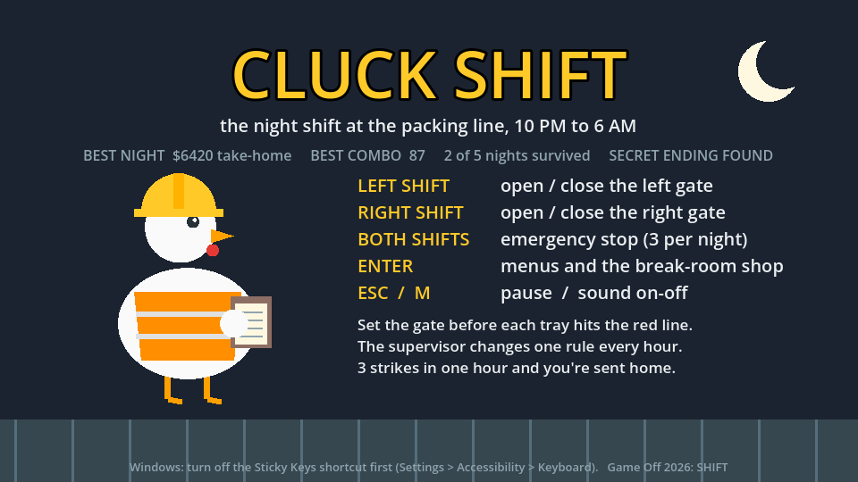


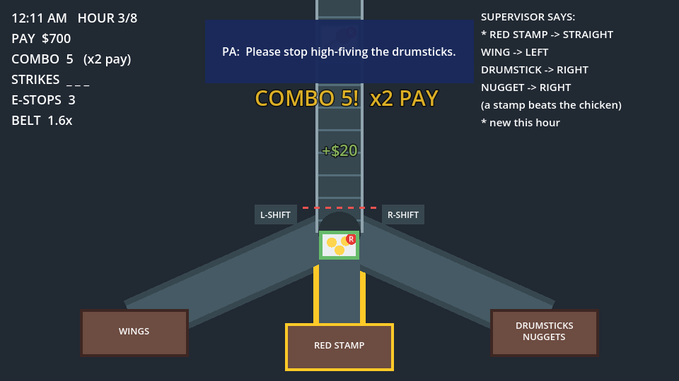

## 6. Core loop

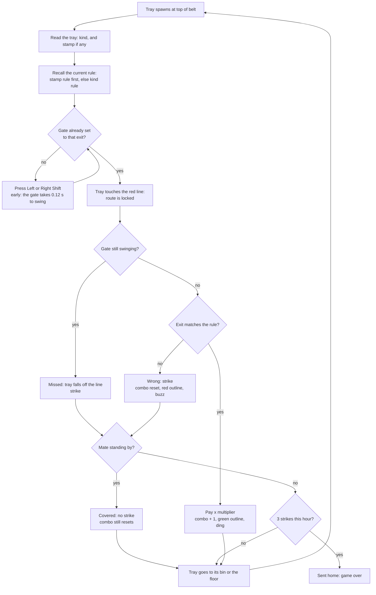

Several trays are on the belt at once, so the real rhythm is: set the gate for the front tray, then look up at the
next one while the front tray is still travelling.

## 7. Gates

### 7.1 Route model

The fork has three exits: `left`, `center` (straight on) and `right`. The game stores a single `route`:

- Both gates closed means `route = "center"`: trays go straight.
- Left gate open means `route = "left"`. Right gate open means `route = "right"`.

Both gates can never be open at once. That avoids the question of where a tray goes when both are open, and keeps
"both keys together" free for the emergency stop. The gates close at the start of every hour.

### 7.2 Gate state machine

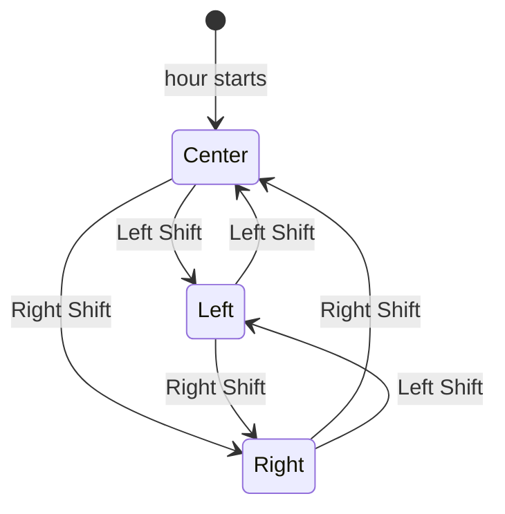

| Current route | Left Shift | Right Shift |
|---|---|---|
| center | left | right |
| left | center | right |
| right | left | center |

The rule fits in one line: `route = "center" if route == side else side`. Every route is one press away from every
other route, so the player never needs two presses to reach a target, which is what makes "two presses at once"
safe to read as an emergency stop.

### 7.3 Gate swing and missed trays

Every toggle starts the gate swinging for `swing_seconds` (0.12 s); both gate boxes flash orange while it swings. A
tray that reaches the red line while the gate is swinging is **missed**: it tumbles off the line to the floor and is a
strike, whatever the gate was swinging towards.

- This is the brief's "missed tray". A press made in good time never misses; a panicked last-frame press does.
- 0.12 s is shorter than the both-Shifts window, so it never adds to the emergency stop's timing (tested).
- The swing keeps running during an emergency stop, but nothing reaches the red line then.

## 8. Emergency stop

### 8.1 Rules

- Pressing **both Shifts within 0.15 s** of each other (`ShiftState.BOTH_SHIFT_WINDOW`) is an emergency stop.
- For `estop_seconds` (2.5 s) the belt halts, trays freeze, no new trays spawn, the speed ramp pauses and **the hour
  clock stops** (both the `HourTimer` and the clock on the HUD).
- The gates still work during the stop. That is the point: it buys time to fix the gate.
- `estops` (3) per **night**, not per hour. With none left, the double press is refused (buzz) and nothing happens.
- A double press during a stop is refused and does not use a charge, so stops cannot be stacked.
- The double press never changes the gate: the first key's toggle is undone.

### 8.2 Detection logic

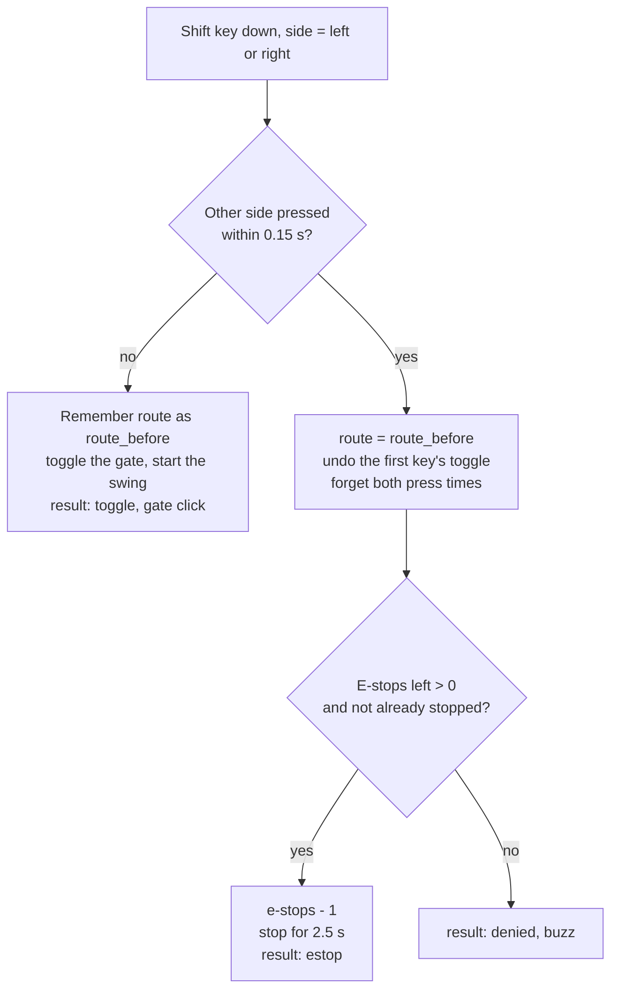

Press times are measured on the game clock (`ShiftState.clock`), not the wall clock, so the logic behaves the same in
tests that run faster than real time. Forgetting both press times after a pair means a quick third press starts
fresh.

### 8.3 Edge cases

| Situation | Result |
|---|---|
| Same Shift pressed twice quickly | Two toggles (gate opens and closes). No stop. |
| Left, then Right 0.2 s later | Two toggles. Too slow to count as "both". |
| Left and Right in the same frame | Emergency stop, gate unchanged. |
| Both again during a stop | Refused, no charge used, gate unchanged. |
| Both with 0 charges left | Refused, buzz, gate unchanged. |
| Holding a Shift | Echo events ignored, so it counts as one press. |
| Shift on a tally, game over or win screen | Ignored. Only Enter or Space do anything. |

## 9. Trays

### 9.1 Kinds and stamps

| Tray | Drawing | Colour | Appears |
|---|---|---|---|
| Wing | Orange angular wing | `#ffa726` | All night |
| Drumstick | Brown ball on a bone | `#a1653a` | All night |
| Nugget | Three small yellow circles | `#ffd54f` | All night |
| Tender | Two long golden strips | `#d4a373` | From 1 AM (a note adds it) |
| Red stamp | Round red badge with "R", top right | `#e53935` | 12 AM to 5 AM |
| Blue stamp | Diamond blue badge with "B", top right | `#1e88e5` | From 3 AM |

Kinds and stamps differ in shape as well as colour, so they can be told apart without colour vision. A new tray's
kind is picked uniformly from the kinds that currently have a rule. While any stamp rule exists, `stamp_chance` (30%)
of trays get a stamp, picked uniformly from the stamps that have a rule.

**A stamp rule beats the kind rule.** A red-stamped wing goes where red stamps go. A tray with no stamp, or with a
stamp that has no rule, goes where its kind goes.

### 9.2 Tray lifecycle

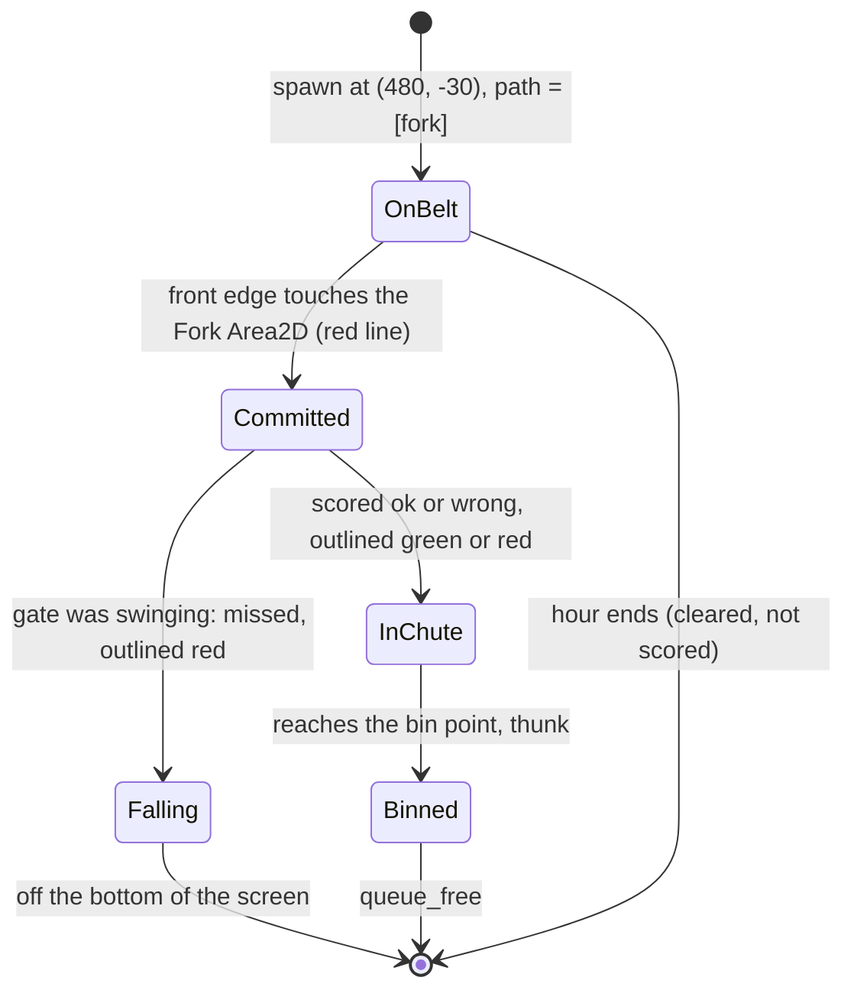

A tray is scored exactly once (`Tray.routed` guards the handler). An emergency stop freezes trays in every state.
When the hour ends, trays still on the belt are cleared without being scored, so the last seconds of an hour can
never cost a strike.

### 9.3 The commit point (the red line)

The Fork is an `Area2D` with an 80 x 20 rectangle centred at (480, 305), so its top edge is at y = 295. A tray is
52 x 36. When its front edge touches y = 295 (tray centre at y = 277), Godot reports the overlap and the tray is routed
by whatever the gate says at that moment. The red dashed line is drawn exactly at y = 295 (`Belt.DECISION_Y`), so
what the player sees matches what the physics does.

## 10. Scoring

### 10.1 Formulas

```
correct sort:  combo      = combo + 1
               multiplier = min(1 + floor(combo / 5), 5)
               pay        = pay + pay_per_tray * multiplier
wrong/missed:  combo      = 0
               if mates > 0: mates = mates - 1    ("covered": no strike)
               else:         strikes = strikes + 1 (pay is never taken away)
end of hour:   bonus      = clean_hour_bonus if strikes == 0 and at least one tray sorted, else 0
               pay        = pay + bonus
accuracy     = correct / sorted over the night    (0 when nothing sorted)
sent home    = strikes this hour >= strikes_allowed
wallet       = pay - spent                        (what you can spend, and your take-home pay)
```

The multiplier is computed after the combo goes up, so the 5th correct tray in a row is the first paid at x2.
**The combo carries across hours**; strikes do not.

### 10.2 Multiplier table (pay_per_tray = 10)

| Combo after the sort | Multiplier | Pay for that tray |
|---|---|---|
| 1 to 4 | x1 | $10 |
| 5 to 9 | x2 | $20 |
| 10 to 14 | x3 | $30 |
| 15 to 19 | x4 | $40 |
| 20+ | x5 (cap) | $50 |

Worked example (a test): four wings right ($40), a fifth ($20, total $60), then a nugget sent left: strike, combo 0,
pay stays $60, accuracy 5/6 = 83%. A perfect night is about 405 trays: $490 for the first 19, then $50 each, plus
8 clean-hour bonuses of $100: the headless autoplayer earns **$20,590**.

### 10.3 Strikes

- A strike is a tray sent to the wrong exit, or a tray that misses a swinging gate, unless Mate's Help covers it.
- 3 strikes **in one hour** and you are sent home, immediately. Strikes reset at the start of every hour.

## 11. The night

### 11.1 Hours and clock

Eight hours, 10 PM to 6 AM, each `hour_seconds` (75 s) of play. The HUD clock runs from `10:00 PM` to `5:59 AM`,
one in-game minute per 1.25 s. The clock, the `HourTimer` and the belt ramp all stop during an emergency stop.

Each hour starts the same way: the belt clears, the gates close, strikes reset, the supervisor's note applies and is
shown on a sticky note for `note_seconds` (4 s), and the first tray spawns when the note goes away.

### 11.2 Belt per hour

Speed and interval slide linearly from the hour's first to its second value:

```
p           = hour_elapsed / hour_seconds          (0 to 1, not counting emergency stops)
speed(p)    = lerp(speed[0], speed[1], p)          px/s
interval(p) = lerp(interval[0], interval[1], p)    s between trays
```

| Hour | Speed (px/s) | Seconds between trays | Gap between trays | Time from spawn to red line | Trays (approx.) |
|---|---|---|---|---|---|
| 10 PM | 100 to 150 | 2.6 to 2.0 | 260 to 300 px | 3.1 to 2.0 s | 31 |
| 11 PM | 130 to 180 | 2.2 to 1.7 | 286 to 306 px | 2.4 to 1.7 s | 36 |
| 12 AM | 150 to 200 | 1.9 to 1.5 | 285 to 300 px | 2.0 to 1.5 s | 42 |
| 1 AM | 170 to 220 | 1.7 to 1.3 | 289 to 286 px | 1.8 to 1.4 s | 47 |
| 2 AM | 190 to 240 | 1.5 to 1.2 | 285 to 288 px | 1.6 to 1.3 s | 53 |
| 3 AM | 210 to 255 | 1.3 to 1.05 | 273 to 268 px | 1.5 to 1.2 s | 60 |
| 4 AM | 225 to 270 | 1.15 to 0.95 | 259 to 257 px | 1.4 to 1.1 s | 68 |
| 5 AM | 240 to 280 | 1.05 to 0.9 | 252 px | 1.3 to 1.1 s | 73 |

```mermaid
xychart-beta
    title "Belt speed through the night (px/s, start and end of each hour)"
    x-axis ["10PM", "", "11PM", "", "12AM", "", "1AM", "", "2AM", "", "3AM", "", "4AM", "", "5AM", ""]
    y-axis "px/s" 0 --> 300
    line [100, 150, 130, 180, 150, 200, 170, 220, 190, 240, 210, 255, 225, 270, 240, 280]
```

- **Gap** is `speed x interval` when a tray spawns. All trays move at the same speed, so gaps never shrink after
  spawning, and every gap is far above the 36 px tray height (tested for every hour).
- **Seconds between trays** is the decision budget per tray. It never drops below 0.9 s (tested: at least 0.6 s).
- **Time from spawn to red line** is the 307 px from spawn to commit divided by speed: how long you can read a tray.
- Each hour starts a little slower than the last one ended, so a new rule arrives with a moment to adjust.

## 12. Supervisor notes

### 12.1 Note types

A note is data in `hours[i].note`. After the first hour, every note changes **exactly one rule** (tested):

| Field | Effect | Example |
|---|---|---|
| `route` `{kind: exit}` | Moves a kind to an exit. A kind with no rule yet starts spawning. | `{"nugget": "right"}`, `{"tender": "left"}` |
| `stamp` `{colour: exit}` | Stamped trays of that colour go to that exit, beating their kind. | `{"red": "center"}` |
| `stamp` `{colour: null}` | Cancels a stamp rule. Those stamps stop appearing. | `{"red": null}` |
| `swap` `[exit, exit]` | Every kind and stamp going to one exit now goes to the other. | `["left", "right"]` |

When a note applies, the rules board marks every rule it changed with `*` (a cancelled stamp is listed as
"cancelled"), and the bins relabel. Notes change a copy of the rules, never the data a new night starts from (tested).

### 12.2 The night's rules, hour by hour

| Hour | Supervisor note | LEFT bin | STRAIGHT bin | RIGHT bin |
|---|---|---|---|---|
| 10 PM | "Wings LEFT, drumsticks RIGHT, nuggets STRAIGHT on." (no change) | wings | nuggets | drumsticks |
| 11 PM | "Nuggets now go RIGHT. Same box as the drumsticks." | wings | (empty) | drumsticks, nuggets |
| 12 AM | "Red-stamped trays go STRAIGHT to the bin." | wings | RED STAMP | drumsticks, nuggets |
| 1 AM | "Tenders are on tonight. Tenders go LEFT." | wings, tenders | RED STAMP | drumsticks, nuggets |
| 2 AM | "Maintenance swapped the chutes." | drumsticks, nuggets | RED STAMP | wings, tenders |
| 3 AM | "Blue stamp means VIP order. Blue goes LEFT." | BLUE STAMP, drumsticks, nuggets | RED STAMP | wings, tenders |
| 4 AM | "Wing shortage upstairs. Wings go STRAIGHT now." | BLUE STAMP, drumsticks, nuggets | RED STAMP, wings | tenders |
| 5 AM | "Red stamps were a printer error." | BLUE STAMP, drumsticks, nuggets | wings | tenders |

The 2 AM swap is the hardest moment: every habit built so far is reversed. The play test replays this exact sequence
and checks the board marks each new rule.

### 12.3 Rule lookup

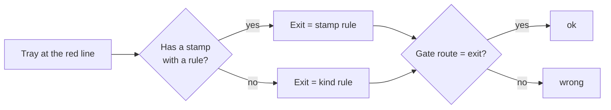

## 13. Game states

### 13.1 State machine

```mermaid
stateDiagram-v2
    [*] --> MENU: game opens
    MENU --> PLAYING: Enter / Space (new night, 10 PM)
    PLAYING --> HOUR_END: HourTimer times out
    PLAYING --> GAME_OVER: 3 strikes this hour
    HOUR_END --> SHOP: Enter
    HOUR_END --> WIN: Enter after the 5 AM hour
    SHOP --> SHOP: Left / Right Shift (choose), Enter on an item you can't afford
    SHOP --> PLAYING: Enter (buy or skip; next hour)
    GAME_OVER --> MENU: Enter
    WIN --> MENU: Enter
```

| State | On enter | Input | Per physics frame | Leaves when |
|---|---|---|---|---|
| MENU | New `ShiftState`, clear trays, show the title screen | Enter, Space | Nothing | Enter |
| PLAYING | Next hour: clear belt, close gates, reset strikes, apply note, show note card, start `HourTimer` (75 s) and the first spawn after 4 s | Shifts | Tick clock and ramp, move trays, pause timers while stopped, hide the note after 4 s | Hour timer, or 3rd strike |
| HOUR_END | Clear belt, `end_hour()` adds the clean bonus and uses up Coffee and Earplugs, show the tally, whistle | Enter, Space | Nothing | Enter |
| SHOP | Show the vending machine on **Skip**, with your wallet and active items | Shifts choose; Enter buys | Nothing | Enter on Skip or an affordable item |
| GAME_OVER | Stop timers, big shake, show "SENT HOME at 1:23 AM", earned, spent, trays, accuracy, best combo | Enter, Space | Nothing (belt frozen) | Enter |
| WIN | Stop timers, pick the ending (`ShiftState.ending()`), show the dawn scene and the payslip: earned, spent, take-home pay, trays, accuracy, best combo, strange trays let through | Enter, Space | Nothing (the ending animates itself) | Enter |

Esc or P pauses PLAYING without leaving it (section 23.1). The factory hum and the music loop only in PLAYING. The title shows only in MENU, the vending machine only in SHOP and the ending
only in WIN. Leaving PLAYING turns the lights back on, so a flicker never carries into a tally.

Every new night builds a brand-new `ShiftState` in MENU, so nothing from the last night can leak into the next one.

### 13.2 One physics frame

```mermaid
sequenceDiagram
    participant Input
    participant Main as main.gd
    participant Logic as ShiftState
    participant Tray as Tray (Area2D)
    participant Fork as Fork (Area2D)

    Input->>Main: Shift key down (any time between frames)
    Main->>Logic: press_shift(side)
    Logic-->>Main: toggle (swing starts) / estop / denied
    Main->>Main: play sound, refresh HUD and gates

    Note over Main: _physics_process(delta), PLAYING only
    Main->>Logic: tick(delta)
    Logic-->>Main: distance to move (0 while stopped)
    Main->>Main: pause spawn and hour timers if stopped, hide note after 4 s,<br/>show the PA (or radio) banner while pa_left > 0,<br/>dim the line while lights_out(), pulse the hazard tint
    Main->>Tray: advance(distance) for each tray
    Tray-->>Main: true when the path is used up
    Main->>Main: thunk and free trays that reached their bin

    Note over Fork: physics server checks overlaps
    Fork->>Main: area_entered(tray)
    Main->>Logic: sort(kind, stamp)
    Logic-->>Main: ok / wrong / missed / covered / escaped / caught
    Main->>Tray: path to bin (or floor if it missed), outline green or red (strange trays: plain)
    Main->>Main: sound, popup, shake or puff; game over if sent home
```

## 14. Audio

All sounds go through the `Sfx` autoload: `Sfx.play(name, pitch)` and `Sfx.loop("hum", on)`. Every sound is
synthesized in code at start-up from noise bursts, sine and saw waves, pitch sweeps and envelopes (`scripts/sfx.gd`),
so the game has no audio files and no licences to track.

| Hook | Plays when | How it is made |
|---|---|---|
| `gate_click` | A Shift toggles a gate | Noise burst plus a 2.4 kHz tick, 0.07 s |
| `ding` | Correct sort; pitch rises with the multiplier, and again on combo milestones | Bell: 1320 Hz with two overtones, decaying |
| `strike_buzz` | Wrong sort; refused emergency stop; can't afford | 110 Hz saw with a 9 Hz wobble |
| `missed` | A tray misses a swinging gate | Slide whistle, 1300 Hz down to 220 Hz |
| `tray_thunk` | A tray lands in a bin | Pitch drop 150 to 55 Hz plus a click |
| `estop` | Emergency stop starts | Square-wave siren wobbling 470 to 830 Hz |
| `clock_in` | An hour starts; the 6 AM win | Two-note bell, 660 then 990 Hz |
| `hour_end` | An hour ends | Factory whistle chord with breath noise |
| `cash` | Buying in the shop | Noise "ka" then a two-note "ching" |
| `select` | Moving the shop selection; a covered strike | Short 1.2 kHz tick |
| `pa_jingle` | A PA announcement starts | Ding-dong, 784 then 622 Hz |
| `hum` (loop) | The whole time you are on the line | 55 Hz and 110 Hz with a little noise |
| `cluck` | A strange tray escapes (pitched up) or is caught (pitched down); the secret ending | Two quick 950 to 480 Hz sweeps |
| `radio` | The PA picks up clucking instead of an announcement | Static with clucks every 0.32 s, fading out |
| `flicker` | The lights cut out | 100 Hz square buzz through noise, 0.16 s |
| `music` (loop) | The whole time you are on the line, faster every hour (section 23.4) | Plucked bass riff, kick and hi-hat, 4 s at 120 bpm |

## 15. Tuning knobs

| Knob | Where | Value | Effect |
|---|---|---|---|
| `routes` | rules.json | wing left, drumstick right, nugget center | Starting rules; the kinds listed spawn. |
| `hours[i].speed` / `interval` | rules.json | see 11.2 | Belt range for each hour. |
| `hours[i].note` | rules.json | see 12.2 | The supervisor note and its one rule change. |
| `hour_seconds` | rules.json | 75 | Length of an hour. |
| `note_seconds` | rules.json | 4 | How long the note shows before the first tray. |
| `pay_per_tray` | rules.json | 10 | Base pay per correct tray. |
| `clean_hour_bonus` | rules.json | 100 | Bonus for an hour with no strikes. |
| `strikes_allowed` | rules.json | 3 | Strikes in one hour before you are sent home. |
| `estops` / `estop_seconds` | rules.json | 3 / 2.5 | Emergency stops per night and their length. |
| `stamp_chance` | rules.json | 0.3 | Share of trays stamped while a stamp rule exists. |
| `swing_seconds` | rules.json | 0.12 | Gate swing time; a tray arriving mid-swing is missed. |
| `shop` | rules.json | Coffee $150, Mate's Help $250, Earplugs $100 | Names, prices and descriptions of the three items. |
| `coffee_factor` | rules.json | 0.8 | Coffee multiplies speed and divides interval by this. |
| `pa.from_hour` / `every` / `seconds` | rules.json | 2 (12 AM) / 9 to 16 s / 3.5 s | When the PA starts, how often, how long. |
| `pa.lines` | rules.json | 8 lines | What the PA says. |
| `strange.from_hour` | rules.json | 4 (2 AM) | When the strange night starts. |
| `strange.chance` / `max_per_hour` | rules.json | 0.06 / 4 | Chance a tray is strange, and the cap per hour. |
| `strange.radio_chance` / `radio` | rules.json | 0.5 / 5 lines | Share of announcements that are radio clucks, and what they say. |
| `strange.flicker` | rules.json | every 9 s, dark 0 to 0.2 and 0.45 to 1.2 | When the lights go out in each cycle. |
| `endings` | rules.json | normal, secret | Title and line for each ending. |
| `Juice.SHAKE_DECAY` / `SHAKE_PIXELS` | juice.gd | 3 per s / 10 px | Screen shake feel. |
| `BOTH_SHIFT_WINDOW` | shift_state.gd | 0.15 s | How close two Shifts must be to count as "both". |
| `COMBO_STEP` / `MAX_MULTIPLIER` | shift_state.gd | 5 / 5 | Combo curve. |
| `Belt.SPAWN`, `FORK`, `EXITS`, `FLOOR` | belt.gd | see section 5 | Layout. |

Field reference: [data-format.md](data-format.md).

## 16. Known issues and risks

| Issue | Impact | Mitigation |
|---|---|---|
| Windows Sticky Keys | Pressing Shift 5 times opens the Sticky Keys prompt, in the desktop build and in browsers on Windows. | The README and the title screen tell players to turn off the shortcut (#21). A game cannot turn it off. |
| Shift location not reported | Some setups report Shift with no location (#22). | Fixed: Z and / take over the gates, with a notice on the title and HUD. |
| Browser focus | The web build only hears keys after it has focus. | `html/focus_canvas_on_start`; Enter on the menu needs a click or key on the page anyway. |
| Random streaks | Uniform random kinds can produce runs. | Fine so far; a shuffled bag per hour if playtests say it feels unfair. |
| Flicker and photosensitivity | Flashing can trigger seizures. | The lights only dim (to about 30%, never black and white), at most 2 flashes in any second (WCAG 2.3.1 allows 3), once every 9 s. A data test enforces the 2-per-second limit. |
| Secret too hidden | Players may never find the secret ending. | Three hints: the radio ("STRAIGHT on... the DOCK"), the "TO LOADING DOCK" sign under the straight bin, and the payslip line "Let through to the dock: 3 of 13". |

---

## 17. The break-room shop

After each hour's tally (not after 5 AM) you go to the break room. One purchase, or skip.

| Item | Price | Effect | Lasts |
|---|---|---|---|
| Coffee | $150 | Belt speed x 0.8 and tray interval / 0.8: slower, and trays come less often, so the gap between trays is unchanged | Next hour |
| Mate's Help | $250 | Your mate covers your next strike (wrong or missed): no strike, but the tray still doesn't pay and the combo still resets | Until used; you can stack several |
| Earplugs | $100 | No PA announcements | Next hour |
| Skip | free | Keep your pay | |

- **Controls:** Left / Right Shift move the selection (it wraps), Enter buys the selected item and starts the next
  hour. The shop opens on **Skip**, so pressing Enter straight through never spends money.
- **Can't afford:** the price shows red with "can't afford"; Enter on it buzzes, shakes slightly and stays in the shop.
- **The trade-off:** everything spent comes off your take-home pay, which is the score on the win screen. Buying is
  insurance against being sent home; skipping is betting on yourself.

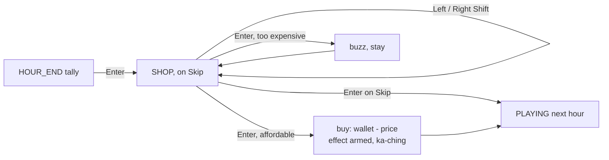

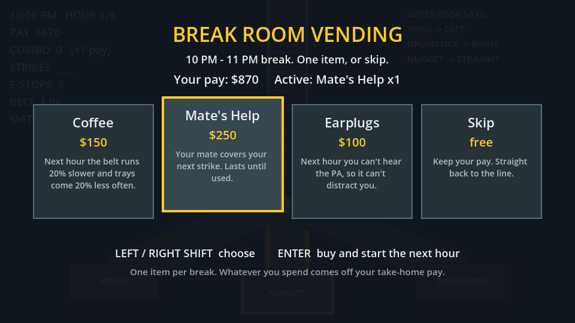

## 18. PA announcements (distraction)

From 12 AM (`pa.from_hour` = 2) the factory PA interrupts: a ding-dong, then a blue banner over the top of the belt for
3.5 s with a silly announcement ("Please stop high-fiving the drumsticks."). The banner hides trays at the top of the
belt, so you see them later than usual. The next announcement comes 9 to 16 s after the last one ends.

- The first one in an hour waits until after the supervisor's note.
- It runs on the game clock, so an emergency stop does not stop it.
- Earplugs block it for an hour. Announcements never overlap (tested: `every` minimum > `seconds`).
- Timing uses `ShiftState.rng`, so tests can seed it.

## 19. Juice

Feedback that changes nothing about the rules lives in `scripts/juice.gd`.

| Event | Feedback |
|---|---|
| Correct sort | "+$20" floats up from the fork in green; a feather puff in the food's colour when the tray lands |
| Combo of 5, 10, 15... | "COMBO 10! x3 PAY" in big yellow text; the ding pitches up |
| Higher multiplier | Each ding is a little higher (+8% per multiplier step) |
| Wrong sort | "STRIKE!" in red, a red puff at the fork, screen shake |
| Missed tray | "MISSED!", the tray tumbles off the line, screen shake |
| Mate covers | "YOUR MATE COVERED IT!" in blue, a small shake |
| Emergency stop | "EMERGENCY STOP!", a small shake, the screen pulses red until the belt restarts, siren |
| Sent home | A big shake behind the game-over card |
| Buying | The item's name pops up as the next hour starts; ka-ching |

Screen shake uses trauma: each event adds trauma (capped at 1), it decays at 3 per second, and the camera offset is
`10 px x trauma squared`, so small knocks stay small and big ones are big.

## 20. Title screen

A night-shift chicken in a hard hat and hi-vis vest, holding a clipboard and bobbing gently; a moon; a moving belt
along the bottom; the four controls; the rules in three lines; a blinking "PRESS ENTER TO CLOCK IN"; and the Sticky
Keys hint. All drawn with shapes in `scripts/title.gd`. Game over and the win screen return here.

---

## 21. The strange night (Phase 4)

At 2 AM (`strange.from_hour` = 4) the night gets strange. It stays light and cartoony: nothing is scary, and nothing
in it can get you sent home.

| From 2 AM | What you see | Rules effect |
|---|---|---|
| Strange trays | A chicken in sunglasses and a trench coat, sitting on a tray | No rule covers it: never a strike, never pay, combo untouched |
| Radio clucks | The PA banner turns green: "RADIO? ...bawk... STRAIGHT on..." | A distraction like the PA, and the main hint about the secret |
| Flickering lights | The belt and trays dim for a moment, with an electric buzz | Harder to read trays for about 1 s every 9 s |
| The loading dock | A small "TO LOADING DOCK" sign under the straight-on bin | Where strange trays want to go |

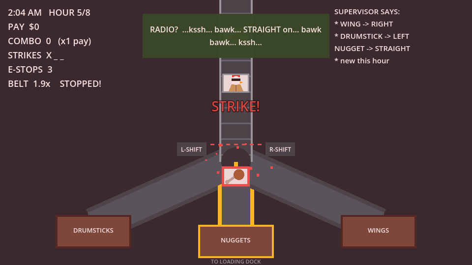

### 21.1 Strange trays

**Spawning.** From 2 AM, each new tray is strange with probability `strange.chance` (0.06), until the hour has had
`strange.max_per_hour` (4). The count resets every hour. Otherwise the tray is picked as before.

```
next_tray():
    if hour >= strange.from_hour and hour_strange < strange.max_per_hour and rng.randf() < strange.chance:
        hour_strange += 1
        return {kind: "stranger", stamp: ""}
    otherwise: a kind from the rules, with a stamp some of the time (section 9)
```

With about 50 trays an hour at 2 AM, that is about 3 strange trays an hour, and roughly 12 to 16 over the four
strange hours (the tested night sees 13). Trays still on the belt when an hour ends are cleared, so they never count.

**Sorting.** At the red line, `sort("stranger")` is checked before anything else:

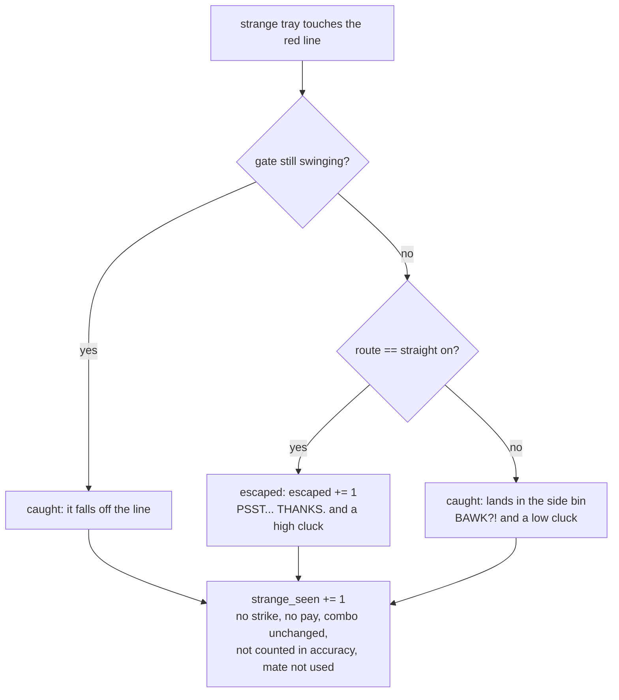

| Result | When | Strikes | Pay | Combo | Accuracy | Mate's Help |
|---|---|---|---|---|---|---|
| `escaped` | Gate settled on straight on | no change | no change | no change | not counted | not used |
| `caught` | Gate on left or right, or still swinging | no change | no change | no change | not counted | not used |

Why no strike: the brief says routing them never costs a strike. The cost of a strange tray is attention. You have to
move the gate for something that pays nothing, in the middle of a fast hour, to keep the secret alive.

### 21.2 Radio clucks

From 2 AM, each PA announcement is a radio cluck with probability `strange.radio_chance` (0.5). The timing is the
PA's (section 18), so it never overlaps an announcement, and Earplugs mute both.

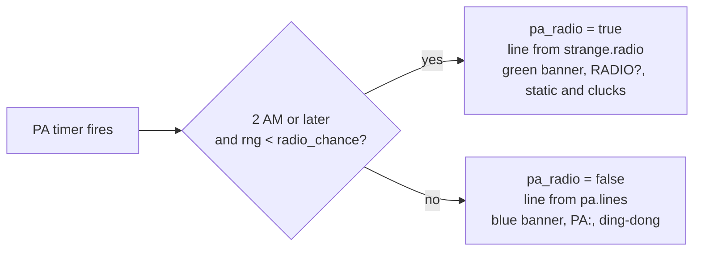

The radio lines are the hints: "STRAIGHT on", "the DOCK", "sunglasses means STRAIGHT", "the trucks leave at DAWN",
"no gates for the coats". A data test makes sure at least one line says STRAIGHT and one says DOCK.

### 21.3 Flickering lights

`lights_out()` is a pure function of the game clock. From 2 AM, the lights are out whenever `clock mod flicker.every`
falls inside one of the `flicker.dark` windows.

| Cycle time (s) | 0 to 0.2 | 0.2 to 0.45 | 0.45 to 1.2 | 1.2 to 9 |
|---|---|---|---|---|
| Lights | dark | on | dark | on |

That is about 11% of the time dark, in two flashes. main.gd tints the belt and the trays to `LIGHTS_OUT` (about 30%
brightness, blue-grey) and plays the `flicker` buzz when they cut out. The HUD, note card and banner stay lit, so the
rules are always readable. The clock keeps running in an emergency stop, so the lights keep flickering then too.

Photosensitivity: dimming, not black and white; at most 2 flashes in any second; once every 9 s. See section 16.

### 21.4 Endings

At 6 AM the WIN state asks `ShiftState.ending()`:

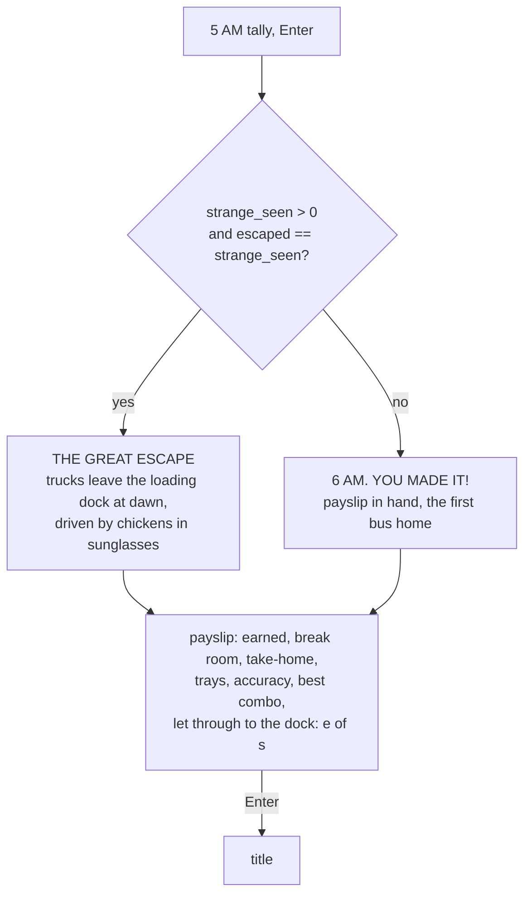

| Ending | Condition | Scene |
|---|---|---|
| Secret: The Great Escape | At least one strange tray reached the red line, and every one that did was sent straight on | Three delivery trucks drive off at dawn; each driver is a chicken in sunglasses |
| Normal | Anything else, including a night with no strange trays | The night bus pulls away with you in the window |

Being sent home is not an ending: GAME_OVER happens before 6 AM and shows the usual card. The titles and lines come
from `endings` in rules.json; the scenes are drawn in `scripts/ending.gd`.

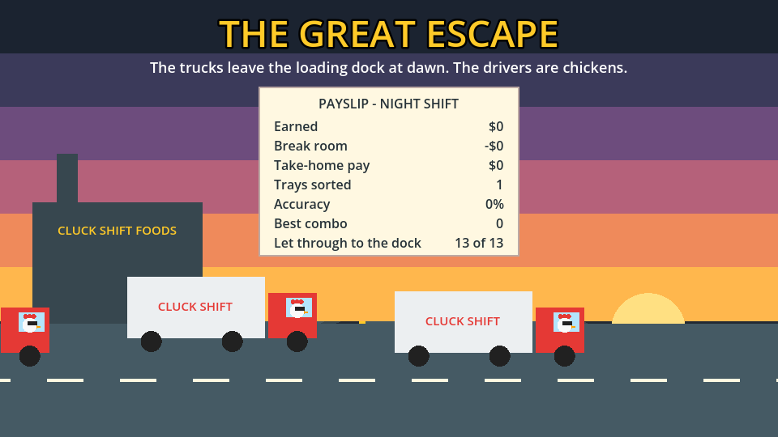

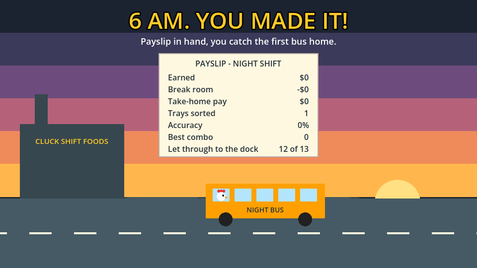

### 21.5 Edge cases

| Case | What happens |
|---|---|
| A strange tray arrives mid-swing with the gate on straight on | Caught (it falls). A swinging gate is never settled. |
| Mate's Help is standing by and a strange tray is caught | The mate is not used: there is no strike to cover. |
| A strange tray is on the belt when the hour ends | Cleared with the belt; it never counts as seen. |
| You buy Earplugs at 2 AM or later | No radio either; the strange trays and the flicker still happen. |
| No strange tray reaches the line all night | Normal ending: there is nothing to have let through. |
| Emergency stop during a flicker | The lights keep flickering; the belt stays stopped. |

---

## 22. Open questions

1. Should the emergency stop be refunded if no tray was near the red line? (Prevents wasting it by accident.)
2. Is 0.12 s of gate swing noticeable enough, or should missed trays get a bigger visual (a wobble on the gate)?
3. Should the 2 AM swap get a longer note time? It reverses every habit at once.
4. Are the shop prices right? A perfect player can afford everything; a struggling one earns roughly $300 to $800 an
   hour. Playtest whether Mate's Help at $250 is bought by the players who need it.

---

## 23. Polish (Phase 5)

Phase 5 leaves the core loop alone: the same belt, gates, rules, hours, shop and endings. It adds what a player
expects around that loop, borrowed from what worked in
[Plunder and Pillage](https://github.com/NiloyBhattacharjee/Plunder_and_Pillage): an Esc menu and a mute key
(its #78 and #56), saved records (#78), a ledger chart (#70), music (#63) and a Windows download (#78).

### 23.1 Pause and mute (#31)

Pausing is a flag inside PLAYING, not a game state: the hour, the note, the strikes and the trays all stay where they
are, so there is nothing to save or restore.

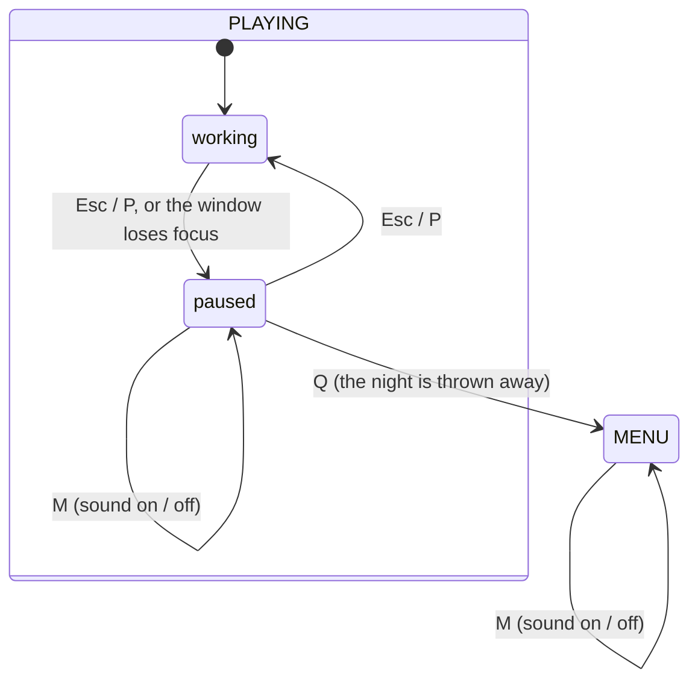

| While paused | How |
|---|---|
| Belt, trays, game clock, belt ramp | `_physics_process` returns before `logic.tick()` |
| PA timing, flicker, emergency stop countdown | all run on `logic.clock`, which only `tick()` advances |
| Spawn and hour Timers | `paused = true` by hand (the stop logic keeps them paused if an emergency stop was running) |
| Shift keys | ignored: no gate moves, no emergency stop |
| Hum and music | stopped; they restart on resume |
| Note card and PA banner | hidden behind the PAUSED card; the next frame after resume shows them again if still due |

Losing window focus (alt-tab, clicking outside the browser tab) pauses too, so the belt never runs on unseen. Esc can
also leave fullscreen in a browser, so **P** does the same job.

Mute sets the master audio bus mute and is saved in the record book, so it survives a reload.

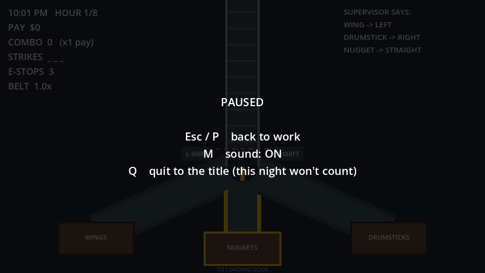

### 23.2 The record book (#32)

`scripts/records.gd` keeps a dictionary in `user://records.cfg` (a `ConfigFile`; on the web Godot stores `user://` in
the browser's IndexedDB):

| Key | Meaning | Updated |
|---|---|---|
| `nights` | Nights finished (sent home or 6 AM) | every finished night |
| `survived` | Nights that reached 6 AM | 6 AM |
| `best_pay` | Best take-home pay (`pay - spent`) | 6 AM only |
| `best_combo` | Best combo in a night | any finished night |
| `best_accuracy` | Best accuracy (0..1) | 6 AM only |
| `secret` | The Great Escape has been seen | 6 AM only |
| `muted` | Sound off | the M key |

A night quit from the pause card is not finished: it changes nothing.

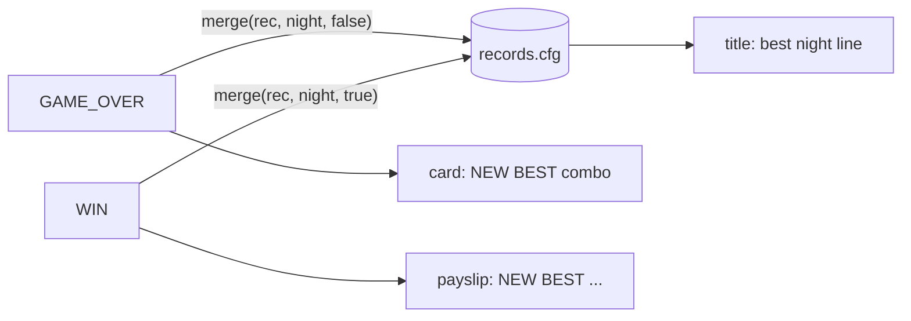

`Records.merge()` is pure (no files), returns the keys it beat, and `Records.describe()` turns them into the
"NEW BEST: take-home pay, best combo" line. Pay only counts at 6 AM so that a player who earns a lot and is then sent
home doesn't hold a "best night" they never finished. The first finished night beats every record it has a non-zero
value for.


### 23.3 The night ledger (#33)

`ShiftState.end_hour()` appends each hour's tally to `ledger`. The 6 AM ending draws it beside the payslip:

- one bar per hour, height = `pay + bonus` scaled to the night's best hour,
- green for a clean hour, amber with one red **X** per strike otherwise,
- the hour (10, 11, 12, 1 ... 5) under each bar.

Being sent home has no chart: by then there are rarely more than one or two hours to show.

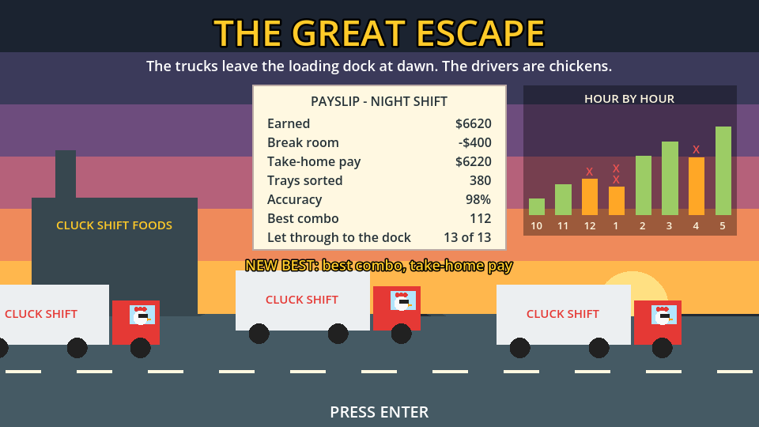

### 23.4 Music (#34)

A 4-second loop synthesized in `sfx.gd` at start-up, like every other sound: two bars at 120 bpm of plucked bass
(A minor riff, A-A-C-A-D-A-E-G then A-A-C-A-D-E-D-C), a kick drum on every beat and a hi-hat on every off-beat. Each
bass note fades in and out over about 3 ms, so the loop never clicks.

It plays only in PLAYING, alongside the hum, at -14 dB so the gameplay sounds stay on top. Each hour it plays faster:

```
pitch_scale = 1 + MUSIC_STEP * hour        MUSIC_STEP = 0.03
```

so 10 PM is 120 bpm and 5 AM is 145 bpm (x1.21), with the pitch rising a few semitones as the night gets frantic.
Earplugs only block the PA and radio; they don't touch the music. Mute does.

### 23.5 Windows download (#35)

A second export preset, **Windows Desktop**: x86_64, the game data embedded in the .exe, no console window. The
result is a single `Cluck Shift.exe` (about 110 MB, almost all of it the Godot engine) to upload to itch.io next to
the web build. See [releasing.md](releasing.md).
