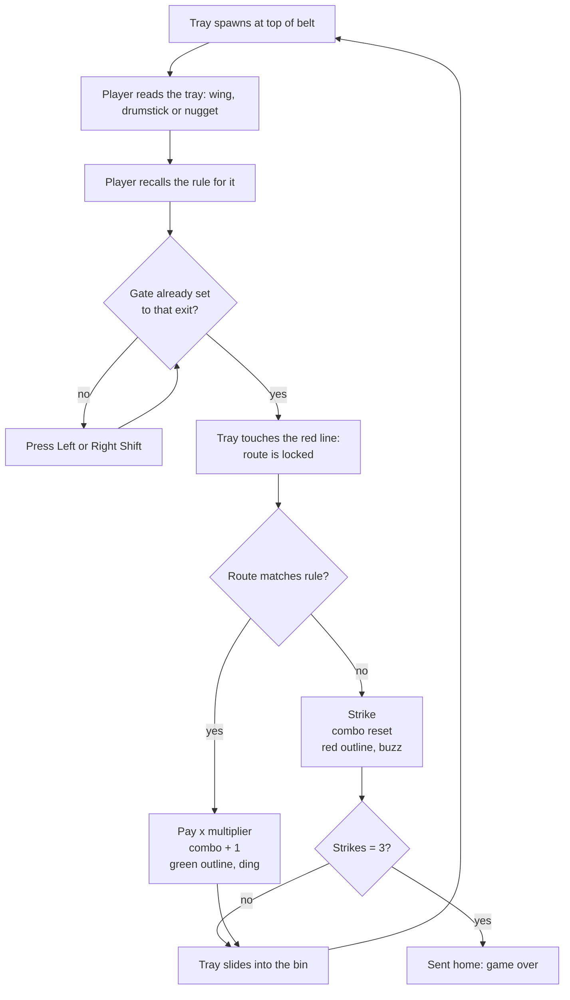
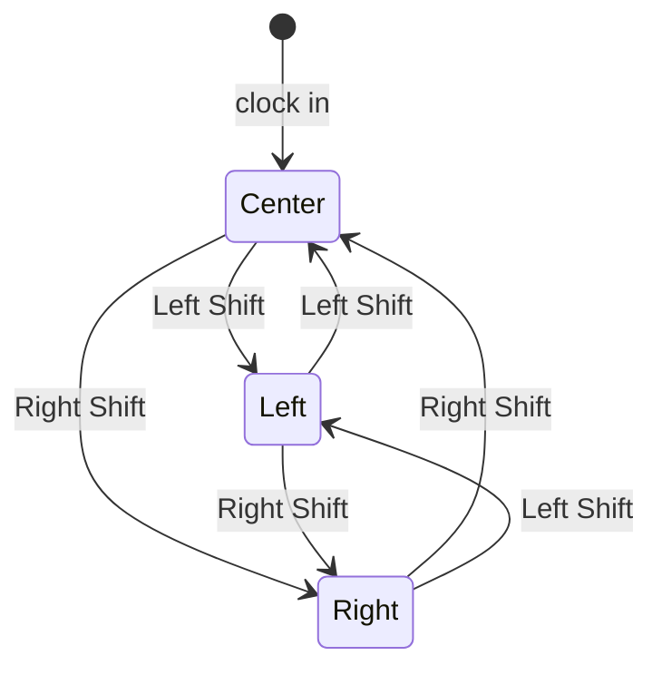
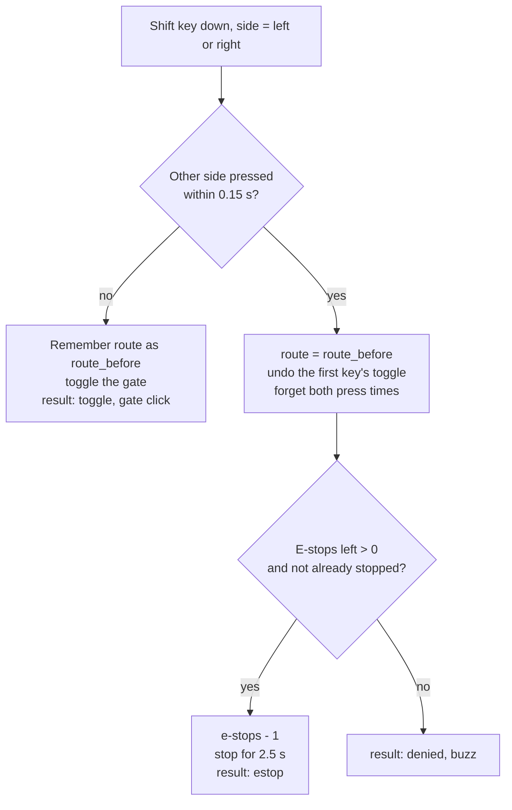
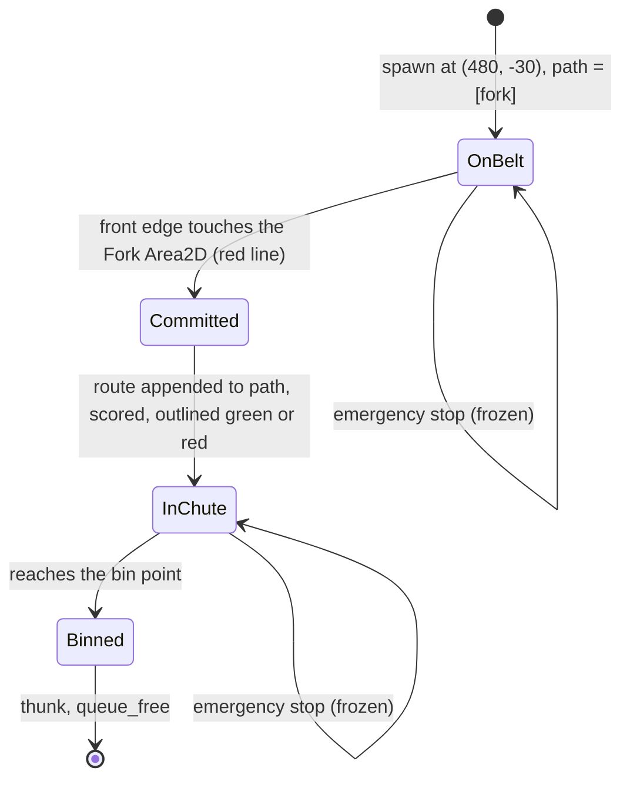
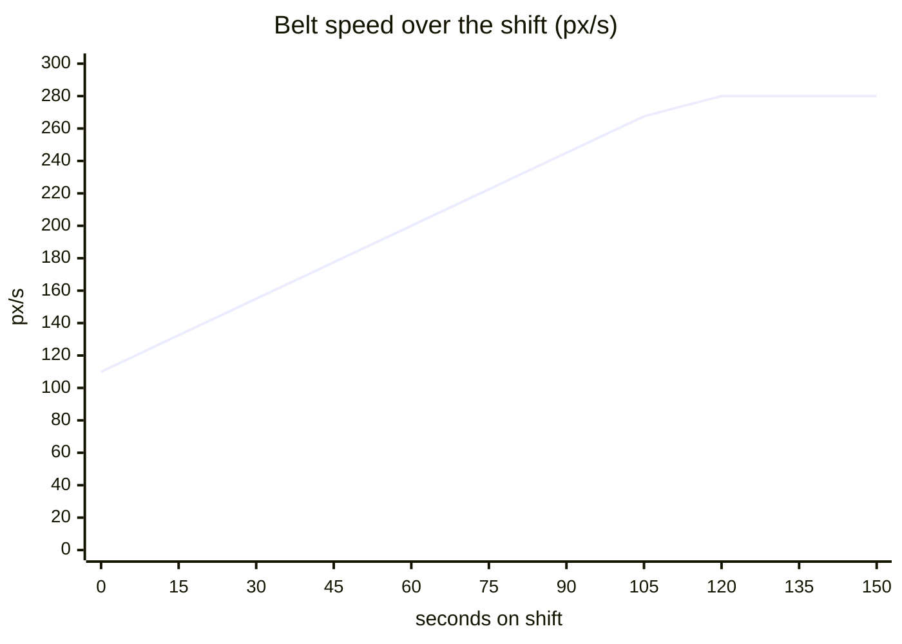
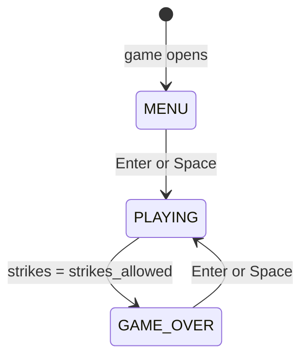
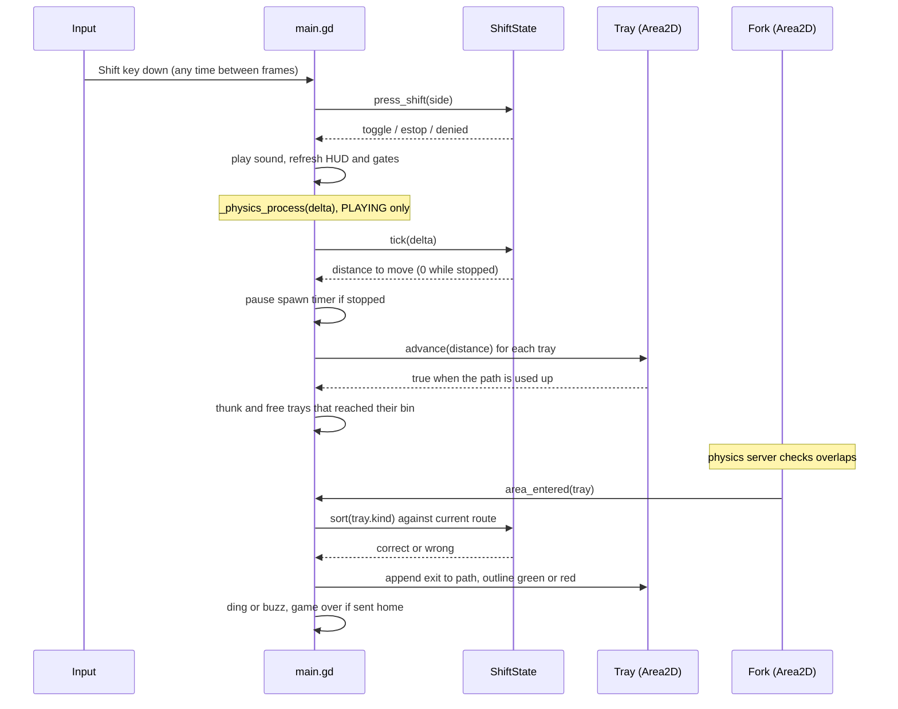
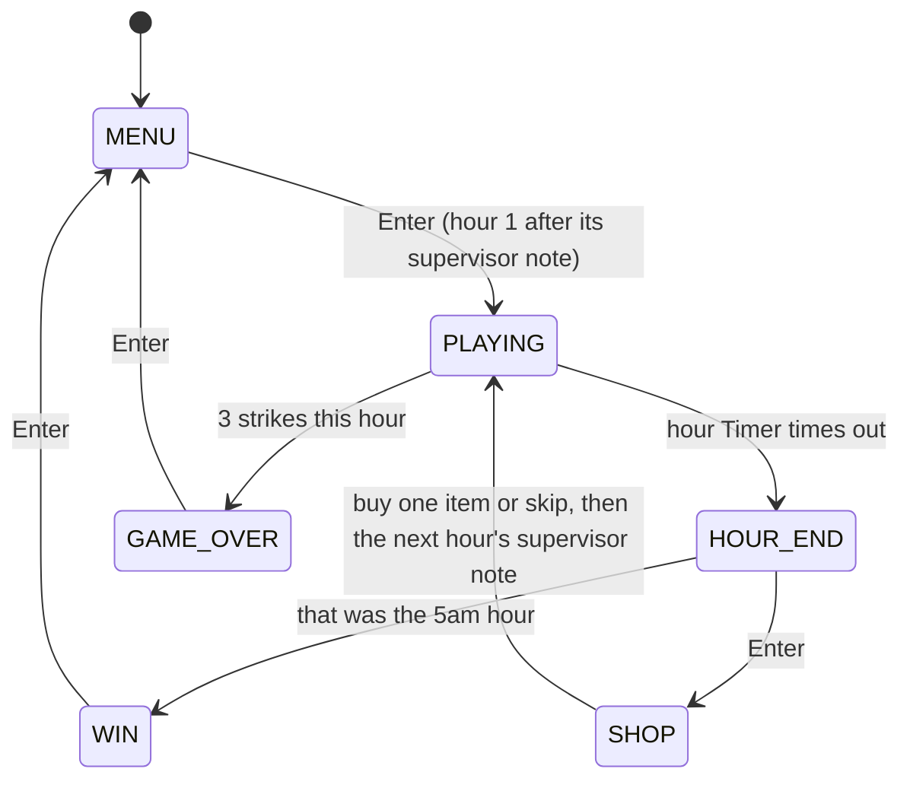
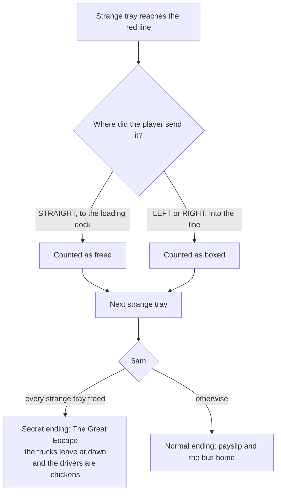

# Cluck Shift: game design document

Game Off 2026 entry. Theme: **SHIFT**. Engine: Godot 4.7 (GDScript), exported to HTML5 for itch.io.

| Phase | Scope | Status |
|---|---|---|
| 1 | One belt, one fork, three tray types, Shift gates, emergency stop, scoring, combo, strikes, game over | **Done** |
| 2 | Night clock 10pm to 6am, per-hour speed ramp, supervisor rule changes, pay tally, win at 6am | Planned |
| 3 | Shop between hours, juice (shake, particles, popups), real sounds, title screen | Planned |
| 4 | Strange trays from 2am, flicker, radio glitches, normal and secret endings | Optional |

Sections 1 to 14 describe what is built and tested. Section 15 is the design for Phases 2 to 4 and is a proposal
until those phases land. Every number below comes from [`data/rules.json`](../data/rules.json) or a named
constant, and the tests in [`tests/`](../tests) check the rules listed here (see [testing.md](testing.md)).

---

## 1. Pitch

You work the night shift on the packing line of a cartoon chicken factory. Trays of wings, drumsticks and nuggets
roll down a conveyor to a three-way fork. You have two buttons, **Left Shift** and **Right Shift**, which swing the
gates at the fork. Read each tray, remember where it goes, set the gate before it reaches the red line. Get it right
and you earn pay and build a combo. Get it wrong three times and the supervisor sends you home.

## 2. How the game uses "SHIFT"

| Meaning of shift | Where it shows up |
|---|---|
| The Shift keys | They are the only gameplay controls. |
| A night shift | The fiction: you clock in at 10pm and the night ends at 6am (Phase 2). |
| Shifting gears | The belt keeps speeding up. |
| Shifting rules | Each hour the supervisor changes one rule (Phase 2). |
| Shifting reality | From 2am things on the line stop making sense (Phase 4). |

## 3. Design pillars

1. **Two keys, nothing else.** Every gameplay decision is a Shift press. Enter and Space only drive menus. No mouse.
2. **Read, then commit.** The player can always see the next tray coming and has a clear moment (the red line)
   after which the decision is locked. A strike is always the player's choice, never a surprise.
3. **Light and cartoony.** Bright shapes, silly supervisor notes, no gore. Mistakes are funny, not grim.
4. **Rules are data.** Routes, pay, strikes and belt speeds live in `data/rules.json`. A designer can retune or add
   rules without touching code.

## 4. Controls

| Input | When | Effect |
|---|---|---|
| Left Shift | Playing | Toggle the left gate. Opening it closes the right gate. |
| Right Shift | Playing | Toggle the right gate. Opening it closes the left gate. |
| Both Shifts (within 0.15 s) | Playing | Emergency stop: the belt halts for 2.5 s. 3 per night. |
| Enter / Space | Menu, game over | Clock in (start a shift). |
| Anything else | Any | Ignored. |

Only key-down events count. Key repeat (echo) is ignored, so holding a Shift does nothing more than one press.
Left and right are told apart by the key's `location` (`KEY_LOCATION_LEFT` / `KEY_LOCATION_RIGHT`), which Godot
reads from the OS on desktop and from `KeyboardEvent.location` in the browser.

## 5. Screen layout

The viewport is 960 x 540 and scales with the window (`stretch/mode = canvas_items`).

```
 x=0                              x=480                              x=960
 +-----------------------------------------------------------------------+ y=0
 | PAY  $120                       |    |          SUPERVISOR SAYS:      |
 | COMBO 7  (x2 pay)               |[T] |  <- tray spawns at y=-30       |
 | STRIKES X _ _                   |    |          WING      -> LEFT     |
 | E-STOPS 3                       |    |          DRUMSTICK -> RIGHT    |
 | BELT 1.4x                       |    |          NUGGET    -> STRAIGHT |
 |                                 |[T] |  belt, 64 px wide              |
 |                                 |    |                                |
 |                      [L-SHIFT] - - - - - [R-SHIFT]   <- red line y=295|
 |                                 \ () /   fork hub at (480, 330)       |
 |                    /             |               \                    |
 |          +--------+         +---------+         +--------+            |
 |          | WINGS  |         | NUGGETS |         | DRUMS  |            |
 |          +--------+         +---------+         +--------+            |
 +-----------------------------------------------------------------------+ y=540
     left bin (190,460)      centre bin (480,480)     right bin (770,460)
```

The open route is drawn in yellow: its gate box, its chute outline, its bin outline and the arrow on the fork hub.
Bin labels are generated from the rules, so if the rules change, the bins relabel themselves.


## 6. Core loop



Several trays are on the belt at once, so the real rhythm is: set the gate for the front tray, then look up at the
next one while the front tray is still travelling.

## 7. Gates

### 7.1 Route model

The fork has three exits: `left`, `center` (straight on) and `right`. The two gates are not independent. The game
stores a single `route`:

- Both gates closed means `route = "center"`: trays go straight.
- Left gate open means `route = "left"`.
- Right gate open means `route = "right"`.

Both gates can never be open at once. That avoids the question of where a tray goes when both are open, and it keeps
"both keys together" free for the emergency stop.

### 7.2 Gate state machine



| Current route | Left Shift | Right Shift |
|---|---|---|
| center | left | right |
| left | center | right |
| right | left | center |

The rule fits in one line: `route = "center" if route == side else side`.

Every route is one press away from every other route. The player never needs two presses to reach a target, which is
what makes "two presses in a row" safe to read as an emergency stop.

## 8. Emergency stop

### 8.1 Rules

- Pressing **both Shifts within 0.15 s** of each other (`ShiftState.BOTH_SHIFT_WINDOW`) is an emergency stop.
- The belt halts for `estop_seconds` (2.5 s). Trays freeze, no new trays spawn, the speed ramp pauses.
- The gates still work during the stop. That is the point: it buys time to fix the gate.
- `estops` (3) per night. With none left, the double press is refused (buzz) and nothing else happens.
- A double press during a stop is refused and does not use a charge, so stops cannot be stacked.
- The double press never changes the gate. The first key of the pair toggled a gate before the game knew a second
  key was coming, so that toggle is undone.

### 8.2 Detection logic



Press times are measured on the game clock (`ShiftState.clock`, which advances with each physics step), not the wall
clock, so the logic behaves the same in tests that run faster than real time. Forgetting both press times after a
pair means that a quick third press starts fresh and is not paired again.

### 8.3 Edge cases

| Situation | Result |
|---|---|
| Same Shift pressed twice quickly | Two toggles (gate opens and closes). No stop. |
| Left, then Right 0.2 s later | Two toggles. Too slow to count as "both". |
| Left and Right in the same frame | Emergency stop, gate unchanged. |
| Both again during a stop | Refused, no charge used, gate unchanged. |
| Both with 0 charges left | Refused, buzz, gate unchanged. |
| Holding a Shift | Echo events ignored, so it counts as one press. |
| Shift after game over | Ignored. Only Enter or Space do anything. |

## 9. Trays

### 9.1 Types

| Kind | Drawing | Colour | Default rule |
|---|---|---|---|
| Wing | Orange angular wing shape | `#ffa726` | LEFT |
| Drumstick | Brown ball on a bone | `#a1653a` | RIGHT |
| Nugget | Three small yellow circles | `#ffd54f` | STRAIGHT |

The three kinds differ in shape as well as colour, so they can be told apart without colour vision. Each kind is
picked uniformly at random when a tray spawns.

### 9.2 Tray lifecycle



A tray is scored exactly once. `Tray.routed` is set when it enters the Fork area and the handler ignores routed trays.

### 9.3 The commit point (the red line)

The Fork is an `Area2D` with an 80 x 20 rectangle centred at (480, 305), so its top edge is at y = 295. A tray is
52 x 36. When the tray's front edge touches y = 295 (tray centre at y = 277), Godot reports the overlap and the tray is
routed to whatever the gate is set to at that moment. The red dashed line is drawn exactly at y = 295
(`Belt.DECISION_Y`), so what the player sees matches what the physics does.

After commit the tray keeps moving to the fork point and then down its chute. Changing the gate after the red line
only affects the next tray.

## 10. Scoring

### 10.1 Formulas

```
correct sort:  combo      = combo + 1
               multiplier = min(1 + floor(combo / 5), 5)
               pay        = pay + pay_per_tray * multiplier
wrong sort:    combo      = 0
               strikes    = strikes + 1          (pay is not taken away)
accuracy     = sorted_ok / sorted_total          (0 when nothing sorted)
sent home    = strikes >= strikes_allowed
```

The multiplier is computed after the combo goes up, so the 5th correct tray in a row is the first one paid at x2.

### 10.2 Multiplier table (pay_per_tray = 10)

| Combo after the sort | Multiplier | Pay for that tray |
|---|---|---|
| 1 to 4 | x1 | $10 |
| 5 to 9 | x2 | $20 |
| 10 to 14 | x3 | $30 |
| 15 to 19 | x4 | $40 |
| 20+ | x5 (cap, `MAX_MULTIPLIER`) | $50 |

Worked example: four wings correct ($10 each = $40), fifth wing correct ($20, total $60), then a nugget sent left:
strike, combo 0, pay stays $60, accuracy 5/6 = 83%. This exact sequence is a test.

A perfect run of n trays earns `10 * (4*1 + 5*2 + 5*3 + 5*4) = $490` for the first 19, then $50 per tray. The
headless autoplayer sorts 109 trays in 150 s for $4,990.

### 10.3 Strikes

- A strike is a tray sorted to the wrong exit.
- `strikes_allowed` (3) strikes and you are sent home, immediately, mid-belt.
- Phase 1 has no hours, so strikes last the whole run. In Phase 2 the count resets each hour ("3 strikes in one hour").
- A "missed tray" cannot happen in Phase 1: every tray goes down some exit. See section 15.6.

## 11. Difficulty ramp

Phase 1 is one endless shift that keeps getting faster until you are sent home.

```
speed(t)    = min(start_speed + speed_ramp * t, max_speed)             px/s
interval(t) = max(start_interval - interval_ramp * t, min_interval)    s between trays
```

With the shipped numbers (110 + 1.5t up to 280; 2.4 - 0.013t down to 0.9):

| Time on shift | Belt speed | Belt x | Seconds between trays | Gap between trays | Time from spawn to red line |
|---|---|---|---|---|---|
| 0 s | 110 px/s | 1.0x | 2.40 s | 264 px | 2.8 s |
| 30 s | 155 px/s | 1.4x | 2.01 s | 312 px | 2.0 s |
| 60 s | 200 px/s | 1.8x | 1.62 s | 324 px | 1.5 s |
| 90 s | 245 px/s | 2.2x | 1.23 s | 301 px | 1.3 s |
| 115 s+ | 280 px/s | 2.5x | 0.90 s | 252 px | 1.1 s |



- **Gap** is `speed x interval` at the moment a tray spawns. All trays on the belt move at the same speed, so gaps
  never shrink after spawning. The gap is always far above the 36 px tray height, so trays never overlap (tested).
- **Seconds between trays** is the real decision budget: it is the time between one tray locking at the red line
  and the next one arriving there. At full speed that is 0.9 s, kept at 0.6 s or more by a test.
- **Time from spawn to red line** is the 307 px from spawn to commit divided by speed. It is how long the player can
  read a tray before it locks.
- During an emergency stop neither the speed nor the interval ramps, and the spawn timer is paused.

## 12. Game states

### 12.1 Phase 1 state machine



| State | On enter | Input accepted | Per physics frame | Leaves when |
|---|---|---|---|---|
| MENU | Show the title, controls and "Press Enter to clock in" over a dim overlay | Enter, Space | Nothing | Enter or Space |
| PLAYING | Free old trays, `logic = ShiftState.new(cfg)`, unpause and spawn the first tray, hide the overlay | Left and Right Shift | Tick the clock, move trays, bin finished trays, update HUD | 3rd strike |
| GAME_OVER | Stop the spawn timer, show pay, trays sorted, accuracy and best combo | Enter, Space | Nothing (belt frozen) | Enter or Space |

Starting a shift builds a brand-new `ShiftState`, so nothing from the last run can leak into the next one: there is
no reset function with a field to forget.

### 12.2 One physics frame



## 13. Audio hooks

All sounds go through one autoload, `Sfx.play(name)`. Phase 1 generates short square-wave beeps in code so every hook
is audible. Phase 3 replaces them with real sounds behind the same names, without touching any caller.

| Hook | Plays when | Placeholder |
|---|---|---|
| `gate_click` | A Shift toggles a gate | 1400 Hz, 0.03 s |
| `ding` | Correct sort | 990 Hz, 0.12 s |
| `strike_buzz` | Wrong sort, or an emergency stop refused | 80 Hz, 0.35 s |
| `tray_thunk` | A tray lands in a bin | 110 Hz, 0.09 s |
| `estop` | Emergency stop starts | 300 Hz, 0.5 s |

## 14. Tuning knobs

| Knob | Where | Value | Effect |
|---|---|---|---|
| `routes` | rules.json | wing left, drumstick right, nugget center | Which exit each kind belongs in. Kinds listed here are the kinds that spawn. |
| `pay_per_tray` | rules.json | 10 | Base pay per correct tray. |
| `strikes_allowed` | rules.json | 3 | Strikes before you are sent home. |
| `estops` | rules.json | 3 | Emergency stops per night. |
| `estop_seconds` | rules.json | 2.5 | Length of a stop. |
| `belt.start_speed` / `max_speed` | rules.json | 110 / 280 px/s | Belt speed range. |
| `belt.speed_ramp` | rules.json | 1.5 px/s per s | How fast the belt speeds up. |
| `belt.start_interval` / `min_interval` | rules.json | 2.4 / 0.9 s | Time between trays. |
| `belt.interval_ramp` | rules.json | 0.013 s per s | How fast trays bunch up. |
| `BOTH_SHIFT_WINDOW` | shift_state.gd | 0.15 s | How close two Shifts must be to count as "both". |
| `COMBO_STEP` / `MAX_MULTIPLIER` | shift_state.gd | 5 / 5 | Combo curve. |
| `Belt.SPAWN`, `FORK`, `EXITS` | belt.gd | see section 5 | Layout. |

Full field reference: [data-format.md](data-format.md).

---

## 15. The full night (Phases 2 to 4, proposal)

### 15.1 Night timeline

Eight in-game hours, each `hour_seconds` long (default 75 s, configurable). The belt speed ramps within each hour
and the starting speed steps up from hour to hour.

```mermaid
gantt
    title One night on the line (each hour is 75 s of play)
    dateFormat HH:mm
    axisFormat %H:%M
    section Hours
    10pm (rules as on the board)  :h1, 22:00, 1h
    11pm                          :h2, after h1, 1h
    12am                          :h3, after h2, 1h
    1am                           :h4, after h3, 1h
    2am (strange trays begin)     :crit, h5, after h4, 1h
    3am                           :crit, h6, after h5, 1h
    4am                           :crit, h7, after h6, 1h
    5am                           :crit, h8, after h7, 1h
```



### 15.2 Full state machine



| State | Shows | Input |
|---|---|---|
| MENU | Title screen (Phase 3 art) | Enter / Space |
| PLAYING | The belt. At the start of each hour a supervisor note is shown on the belt for a few seconds while the belt runs slowly. | Shifts |
| HOUR_END | Pay tally for the hour: trays sorted, correct, strikes, combo bonus, hour pay, night total | Enter / Space |
| SHOP | One item to buy with pay, or skip | Shifts pick (Left = previous, Right = next), Enter buys |
| GAME_OVER | Sent home, with night totals so far | Enter / Space |
| WIN | 6am: total pay, accuracy, best combo, and the ending | Enter / Space |

The shop is browsed with the Shift keys so that the "Shift keys only" rule holds everywhere outside plain menus.

### 15.3 Supervisor notes (rule changes)

Each hour adds or changes exactly one rule. A note is data, so new notes need no code:

```json
"hours": [
  { "start_speed": 110, "max_speed": 180, "note": null },
  { "start_speed": 130, "max_speed": 200, "note": { "text": "Nuggets now go RIGHT.", "set_route": { "nugget": "right" } } },
  { "start_speed": 140, "max_speed": 220, "note": { "text": "Red-stamped trays go in the bin.", "add_stamp": { "stamp": "red", "route": "center", "chance": 0.25 } } }
]
```

| Note type | Effect | Example |
|---|---|---|
| `set_route` | Moves a kind to a different exit | "Nuggets now go RIGHT" |
| `add_stamp` | Some trays get a stamp; a stamped tray follows the stamp's rule instead of its kind's | "Red-stamped trays go to the bin" |
| `swap` | Two exits swap contents | "Wings and drumsticks have swapped bins" |
| `add_kind` | A new kind starts spawning | "Tenders are on tonight. Tenders go LEFT." |

Rule precedence when a tray matches several rules: stamp rule, then kind rule. The rules board and bin labels are
regenerated from the active rules whenever a note applies.

### 15.4 Pay tally (HOUR_END)

```
hour pay     = sum of tray pay this hour (already includes combo multipliers)
clean bonus  = +$50 if 0 strikes this hour
night total  = night total + hour pay + clean bonus
```

### 15.5 Shop (Phase 3)

One purchase between hours. Prices are placeholders to balance in playtests.

| Item | Price | Effect |
|---|---|---|
| Coffee | $60 | Next hour the belt starts and tops out 20% slower |
| Mate's Help | $120 | Remove one strike (carries into the next hour) |
| Earplugs | $40 | Next hour, distractions (radio, flicker, Phase 4) are blocked |

### 15.6 Missed trays (Phase 2)

Phase 1 cannot miss a tray. Phase 2 adds the bin rule, and with it a way to miss: if a tray crosses the red line in
the 0.15 s after a Shift press and the press turns out to be half of an emergency stop, the gate snaps back. The
proposal is to count a tray as **missed** (a strike) when it commits while the gates are moving: a short 0.1 s
"swing" after each toggle during which the fork is neither open nor closed. That makes late presses visibly risky
instead of silently wrong. To be decided in playtests (open question 1).

### 15.7 The strange night (Phase 4, optional)

From 2am, a few trays carry something no rule covers: a chicken in sunglasses and a trench coat, standing on the tray.
No rule mentions them, so routing them never earns a strike. The lights flicker, and the radio between songs picks up
clucking that sounds a lot like instructions ("...straight... the dock... 6am...").



Earplugs (from the shop) mute the radio hints, which makes the secret ending harder to find but does not block it.

### 15.8 Juice (Phase 3)

| Event | Feedback |
|---|---|
| Correct sort | Small particle puff from the bin, "+$20" popup that floats up |
| Combo reaches 5, 10, 15, 20 | Bigger popup ("x3!"), short pitch-up on the ding |
| Strike | Screen shake (0.2 s, 6 px), red flash on the strikes counter |
| Emergency stop | Belt slats stop, hazard light sweeps, siren |
| Sent home | Supervisor face pops up with a stamp: "GO HOME" |

## 16. Known issues and risks

| Issue | Impact | Mitigation |
|---|---|---|
| Windows Sticky Keys | Pressing Shift 5 times in a row opens the Sticky Keys prompt on Windows desktop builds. | Players turn off the shortcut (README). The browser build has the same issue on Windows. Phase 3: show a hint on the title screen. |
| Shift location not reported | Some keyboards, remote desktops and browsers report Shift with no location; every press then acts as Right Shift. | Tracked as a bug. Possible fallback: physical_keycode or a "press Left Shift" calibration step. |
| Browser focus | The web build only hears keys after it has focus. | `html/focus_canvas_on_start` is on, and Enter on the menu needs a click or keypress on the page anyway. |
| Random streaks | Uniform random kinds can produce runs (5 wings in a row). | Fine for Phase 1. Phase 2 can switch to a shuffled bag per hour if streaks feel unfair. |

## 17. Open questions

1. Should a tray that commits while a gate is mid-swing be a "missed tray" strike (section 15.6)?
2. Should strikes reset each hour (as the brief says) or decay by one per hour? Reset is simpler to explain.
3. Should the emergency stop be refunded if no tray was near the red line? (Prevents wasting it by accident.)
4. Shop browsing with Shifts or with Enter only? Shifts keeps the theme; Enter-only is simpler.
